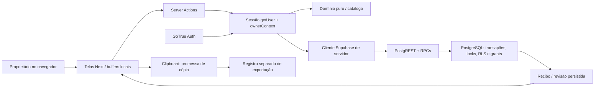
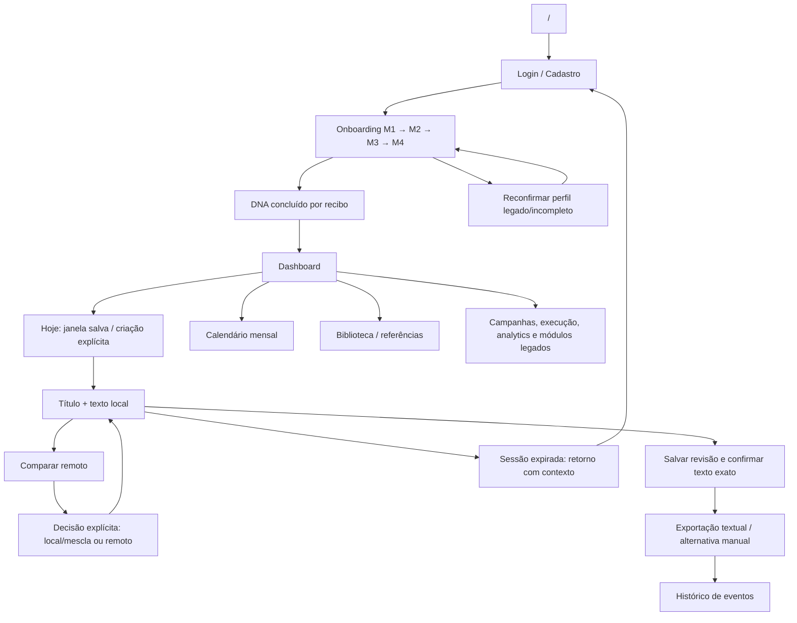

# HOTEL INTELLIGENCE / HOTEL PRO — Relatório técnico de desenvolvimento da candidata C16

> Estado atual: consulte a seção 31 para os arremates de 05/11 e os 190 testes da candidata final. Os recibos anteriores mantêm seus cortes históricos.

**Data editorial:** 05/11/2026, referência de trabalho America/Sao_Paulo.  
**Finalidade:** avaliação técnica externa, inclusive no Perplexity, continuidade de desenvolvimento e comparação entre o que existe, o que foi verificado e o que ainda exige prova.  
**Natureza:** inventário de código e evidências locais. Não constitui homologação, piloto aprovado, implantação, auditoria integral de segurança ou comprovação de resultado comercial.  
**Responsabilidade desta frente:** documentação. O writer da aplicação e da QA permanece responsável por implementação, navegador, execução e publicação.

> **Conclusão utilizável:** a C16 contém um núcleo de planejamento editorial com autenticação de servidor, contexto de proprietário, perfil factual versionado, sete rascunhos persistidos, revisão humana, conflito por revisão e exportação textual controlada. Há evidências de 185 testes aprovados, build e tipos aprovados e cinco verificações reais em backend descartável. Os oito critérios visuais continuam sem aceite integral. O restante do produto reúne superfícies legadas em diferentes graus de integração; existência de tela, query ou nome de recurso não equivale a funcionalidade operacional comprovada.

## 1. Como ler este documento

### 1.1. Vocabulário de evidência

| Expressão | Significado neste relatório |
|---|---|
| Implementado / código observado | Existe implementação examinada na árvore indicada; não afirma execução bem-sucedida do fluxo completo. |
| Testado em domínio/componente | Código ou componente exercitado por testes, com as fronteiras declaradas; não substitui navegador, serviço externo ou PostgreSQL quando há mocks. |
| Backend real em LAB | GoTrue, PostgREST e PostgreSQL locais e descartáveis foram exercitados no recibo citado. Não é produção. |
| PASS parcial visual | Apenas os subcasos expressamente registrados foram observados em navegador. |
| NOT_RUN | Não há execução integral registrada para aquele aceite ou subcaso. |
| Histórico | Evidência de uma execução anterior, com data e candidata próprias. Não descreve disponibilidade atual. |
| Inferência técnica | Consequência deduzida do código, explicitamente identificada; pode exigir reprodução. |
| Proposta / backlog | Trabalho que ainda não foi implementado ou aprovado. |
| Publicado | Só pode ser afirmado mediante recibo e leitura posterior do destino. Este relatório não executa publicação. |

Não somar 185 testes com cinco casos de backend como se fossem 190 critérios independentes de produto. As fronteiras e os objetivos das verificações são diferentes. Não converter contagem de testes em percentual de produto pronto.

### 1.2. Ordem sugerida de avaliação

1. Identidade e corte de código, arquitetura e papéis.
2. Jornada principal: onboarding → DNA → Hoje → sete datas → revisão → exportação.
3. Inventário de telas e contratos, incluindo as limitações das superfícies legadas.
4. Evidências, oito aceites visuais e lacunas.
5. Backlog e perguntas externas, avaliando cada recomendação contra o código existente.

### 1.3. Fontes e portabilidade

Os links de fonte são relativos à pasta deste relatório. Permitem rastrear a análise no pacote local, mas não garantem acesso ao avaliador externo caso os arquivos não sejam enviados junto. O texto explica os contratos essenciais para continuar compreensível sem abrir esses links.

Fontes prioritárias:

- [Checkpoint da rodada](CHECKPOINT.md).
- [Manifesto da árvore corrigida](../qa-visual-20261104b/source-manifest.json).
- [Recibos de typecheck, build e testes](evidence/validated-results.json).
- [Cinco verificações de backend](../qa-visual-20261104b/evidence/backend-verification.json).
- [Roteiro canônico dos oito critérios visuais](../exhaustive-r1/delivery-final/PENDENCIAS_E_REPRO_UI.md).
- [Domínio V2](../candidate/source/lib/hotel/v2/domain.ts), [actions do workspace](../candidate/source/lib/hotel/workspace-actions.ts) e [onboarding](../candidate/source/app/onboarding/actions.ts).
- Código corrente prevalece para comportamento. Documentos C1–C10 descrevem cortes históricos e preservam limites das respectivas execuções; suas contagens e frases “não aplicado” não substituem os recibos posteriores do LAB.

## 2. Identidade, proveniência e corte observado

### 2.1. Identificação exata

| Item | Estado observado |
|---|---|
| Projeto | HOTEL INTELLIGENCE / HOTEL PRO / DAILY PROPHET HOTELS. Os nomes coexistem no produto e nos históricos. |
| Pacote da aplicação | daily-prophet-hotels, versão declarada 1.0.0, private=true. |
| Branch local | codex/hotel-c16-qa-visual-20261104. |
| Commit-base local | 4495a6ff7ab653b77f141cec110f4fde9273db69. |
| Candidata corrigida | Working tree não commitada; não atribuir todas as correções ao commit-base. |
| Identificador agregado declarado no manifesto | 83822a2f681f70c0ae86a377957bfdc5bbaace6218c266bed24a257a9511e3bb. |
| Arquivos do manifesto | 198. Os 198 hashes individuais foram confrontados com a árvore nesta frente documental: nenhuma divergência no momento da conferência. |
| Observação sobre o agregado | O identificador agregado foi lido do manifesto; a conferência documental recalculou os hashes individuais, não a fórmula do agregado. |
| Estado Git conferido | HEAD e branch acima; seis arquivos modificados e dois testes novos, listados abaixo. |
| Remoto/publicação | A candidata e uma eventual cópia sanitizada de publicação são objetos distintos. Publicação não foi executada por esta frente. |

Alterações que compõem este corte:

- app/auth/reset/page.tsx.
- app/dashboard/post-do-dia/page.tsx.
- app/onboarding/actions.ts.
- app/onboarding/page.tsx.
- lib/supabase/middleware.ts.
- tests/ui-feedback-regressions.test.mjs.
- Novos tests/auth-reset-receipt.test.mjs e tests/auth-return-context.test.mjs.

**Trabalho paralelo posterior ao corte:** o writer informou uma frente para navegação e logout geral. Enquanto não houver novo recibo, manifesto e conferência, este documento conserva os achados correspondentes como pendências do corte acima. Uma correção em andamento não integra automaticamente a árvore validada de 198 arquivos.

### 2.2. Origem histórica

A documentação de recomposição identifica uma nova candidata construída a partir de uma base recuperada do Daily Prophet Hotels, reaproveitando formulários, telas e contratos. Ela declara expressamente que não recupera os bytes de uma antiga R2 perdida e não herda seus resultados.

A [recomposição](../candidate/source/docs/RECOMPOSITION.md) referencia a master histórica 38ca624616bbc63756ce4e4c58dadd14d49886a7. Isso é proveniência documental; não prova que a C16 atual seja um incremento já integrado à master remota. PRs antigas divergentes não devem ser tratadas como camadas cumulativas da C16 sem comparação.

Este relatório trata exclusivamente do Hotel. Anexos, manifestos, tecnologias e decisões de outros projetos não constituem especificação do Hotel.

### 2.3. Limites explícitos da missão

- Reutilizar o produto existente.
- Trabalhar com dados sintéticos nos laboratórios.
- Não conectar banco produtivo nem importar bases reais.
- Não implantar, mesclar ou criar infraestrutura produtiva por conta deste documento.
- Não transformar chave pública de um projeto legado em configuração autorizada para outro ambiente.
- Preservar os originais locais e distinguir a cópia sanitizada de distribuição.
- Não incluir valores de credenciais, tokens, endereços reais de usuários, PEMs ou endpoints de projetos legados.

## 3. Propósito do produto e fronteira funcional

O núcleo ajuda o proprietário de uma hospedagem a transformar informações confirmadas sobre seu negócio em rascunhos editoriais, com esforço compatível com sua rotina. A saída principal é texto revisável, não publicação automática.

A jornada prevista é:

1. Entrar ou cadastrar uma conta.
2. Informar identidade, contexto, categoria/experiência, diagnóstico mínimo, tom, vetos, recursos e objetivos em quatro módulos.
3. Concluir uma confirmação persistida do DNA.
4. Abrir Hoje e retomar uma janela salva ou criar explicitamente sete datas.
5. Editar título e texto, comparar fatos e versões.
6. Confirmar uma revisão exata.
7. Copiar a exportação e registrar o evento, quando o clipboard e o backend confirmarem suas respectivas partes.
8. Reabrir o planejamento e o histórico autorizado.

A aplicação não comprova:

- Que uma afirmação feita pelo proprietário é verdadeira fora do sistema.
- Direitos sobre fotos, música, depoimentos, avaliações ou imagem de terceiros.
- Reserva, disponibilidade, preço, ocupação, faturamento, alcance ou retorno financeiro.
- Publicação efetiva em redes sociais.
- Execução de campanhas ou tarefas apenas porque o proprietário as relatou.
- Qualidade científica ou comercial dos scores legados de gamificação e biblioteca.

## 4. Stack real e organização técnica

### 4.1. Dependências observadas

Fonte: [package.json](../candidate/source/package.json) e metadados dos pacotes instalados consultados sem executar a aplicação.

| Tecnologia | Declaração | Versão instalada observada / papel |
|---|---|---|
| Next.js | 16.1.1 | 16.1.1; App Router, Server Components, Server Actions, middleware e build Turbopack. |
| React / React DOM | 19.2.3 | 19.2.3 / 19.2.3. |
| TypeScript | ^5 | 5.9.3. |
| Supabase SSR | ^0.5.2 | 0.5.2; cookies e clientes browser/server. |
| Supabase JS | ^2.90.1 | 2.90.1; Auth, queries PostgREST e RPCs. |
| Tailwind CSS | ^4 | 4.1.18; estilos, responsividade e estados visuais. |
| Anthropic SDK | ^0.39.0 | 0.39.0 instalado; presença da dependência não demonstra chamada autenticada a IA. |
| Framer Motion | ^12.23.26 | Dependência declarada; versão exata não conferida nesta documentação. |
| React Hook Form / resolvers / Zod | ^7.54.0 / ^3.9.0 / ^3.24.0 | Declarados; os contratos críticos examinados também possuem validação própria. |
| Sonner | ^1.7.0 | Feedback visual/toasts. |
| UUID | ^13.0.0 | Dependência declarada; várias operações usam crypto.randomUUID. |
| React Compiler | babel-plugin-react-compiler 1.0.0 | next.config.ts contém reactCompiler=true. |

Node 24.13.0 foi registrado no checkpoint do laboratório anterior. Esse registro não foi usado para alegar a versão atual do processo ou seu funcionamento em 05/11. Python é ferramenta auxiliar do harness de QA e preparação local; não é o backend de negócio da aplicação Hotel.

O backend exercitado pelo LAB real é PostgreSQL + PostgREST + GoTrue. O harness declara imagens PostgreSQL 16, supabase/gotrue:v2.197.0 e postgrest/postgrest:v14.18. Não há FastAPI no núcleo desta candidata.

### 4.2. Scripts existentes

| Script | Comando declarado | O que prova quando executado com recibo |
|---|---|---|
| dev | next dev | Servidor de desenvolvimento; sua inicialização não é homologação. |
| build | next build | Compilação e geração de rotas; não testa a jornada autenticada inteira. |
| start | next start | Execução do build; não foi iniciada por esta frente documental. |
| typecheck | tsc --noEmit | Checagem de tipos. |
| test | node --test tests/*.test.mjs | Suíte mista de domínio, portas, componentes, contratos estáticos e LAB sintético. |
| lab | node lab/server.mjs | LAB explícito sintético, separado dos serviços operacionais. |

Há next.config.ts e next.config.js no pacote. O build validado foi aprovado, mas registrou avisos de múltiplos lockfiles/root inferida e da convenção middleware. O aviso sobre root inferida envolve caminho externo ao projeto; o detalhe local fica restrito ao apêndice. Um pacote portátil precisa conferir configuração efetivamente carregada e lockfile reproduzível. O relatório não resolve essa configuração por suposição.

### 4.3. Camadas

| Camada | Arquivos centrais | Responsabilidade |
|---|---|---|
| Apresentação | app/**, components/layout/**, components/hotel/** | Formulários, edição, comparação, listas, estados e navegação. |
| Ações de aplicação | app/onboarding/actions.ts; lib/hotel/workspace-actions.ts; owner-actions.ts | Sessão/owner confiáveis, leitura, validação, chamadas RPC e validação de recibos. |
| Domínio puro | lib/hotel/v2/domain.ts | Identidade, elegibilidade, datas, matching, fatos, revisão e exportação sem SDK/rede/banco. |
| Catálogo | catalog.ts; seed-original.json | Seed original e overlay editorial explícito. |
| Integração | lib/supabase/client.ts, server.ts, middleware.ts, config.ts | Clientes Supabase, cookies, configuração e sessão. |
| Persistência | SQL histórico e migrations C7–C16 | Schema, policies, grants, triggers e RPCs candidatas exercitadas em banco descartável. |
| Módulos legados auxiliares | content-dna.ts; gamification/engine.ts; billing/plan-limits.ts; ai/context-builder.ts | Leitura de preferências e utilitários herdados; integração e autoridade não são uniformes. |
| LAB sintético | lab/server.mjs, adapter.mjs, client.js, fixtures.mjs | IO sintético e falhas controladas; não é prova de Auth/RLS real. |
| QA integrada descartável | Harness fora da aplicação | PostgreSQL/GoTrue/PostgREST reais locais, gateway TLS/CORS e Next inalterado no escopo do harness. |

## 5. Arquitetura e navegação

### 5.1. Fluxo de dados principal

O cliente participa da experiência, mas os IDs, metadados e confirmações recebidos não são aceitos como autoridade exclusiva. A persistência candidata revalida ownership, estado, revisão, fatos e metadados nas RPCs.

### 5.2. Mapa da jornada

### 5.3. Navegação desktop e mobile

A Sidebar organiza Core, Planejamento, Conteúdo, Execução e Inteligência. A navegação mobile usa um conjunto reduzido de destinos. A superfície “IA” mobile aponta para o Gerador de Legendas, que consulta acervo; esse rótulo não demonstra geração por IA.

No corte manifestado foram encontrados três destinos anunciados sem página correspondente no inventário/build:

| Origem | Destino | Consequência |
|---|---|---|
| MobileNav | /dashboard/collabs | Link para superfície não implementada nesta árvore. |
| Admin | /admin/hoteis | Pipeline anunciado sem página correspondente. |
| Admin | /admin/financeiro | Financeiro anunciado sem página correspondente. |

Há trabalho paralelo anunciado pelo writer sobre essa navegação. O estado “corrigido” depende de recibo posterior ao corte deste relatório.

## 6. Perfis, autoridade e estados de acesso

### 6.1. Papéis de aplicação

| Perfil / contexto | Autoridade observada | Limite |
|---|---|---|
| Visitante sem sessão | Login, cadastro, solicitação de recuperação e callback. | Rotas protegidas redirecionam ou falham conforme contexto. |
| Proprietário autenticado | Vinculado por hotels.owner_id ao actor confiável de getUser. | ID enviado pelo browser não cria acesso a outro hotel. |
| Proprietário sem hotel | Pode iniciar onboarding. | Não há seleção automática de hotel alheio. |
| Proprietário com vários hotéis | Núcleo V2 rejeita ambiguidade. | O produto atual não implementa seleção multihotel de agência apenas porque existe limite “agency”. |
| Proprietário ativo | Escritas do núcleo e exportação, respeitadas todas as demais condições. | Ativo não dispensa revisão factual, consentimento editorial ou revisão esperada. |
| Proprietário em lead/onboarding | Etapas de onboarding permitidas. | Novas escritas editoriais normais exigem ativo. |
| Pausado/cancelado/estado ausente | Histórico autorizado pode permanecer em leitura; escrita bloqueada pelo domínio. | Rotas/layouts e superfícies legadas precisam de provas próprias para todos os estados. |
| Usuário revogado | Policy restritiva C10 verifica users.ativo. | Um JWT antigo não deve restaurar acesso do usuário revogado. Prova depende do ambiente/policies efetivos. |
| Admin interno | app_metadata.hotel_internal_admin === true. | users.role ou user_metadata fornecidos pelo próprio usuário não são autoridade suficiente. |
| Operador de suporte interno | app_metadata.hotel_internal_support === true, identidade ativa e concessão válida por owner/hotel/escopo. | Somente leitura por escopo, sem impersonação ou compartilhamento de senha. |

Fontes: [server-access](../candidate/source/lib/hotel/server-access.ts), [domínio](../candidate/source/lib/hotel/v2/domain.ts), [layout Admin](../candidate/source/app/admin/layout.tsx), [suporte SQL](../candidate/source/sql/MIGRATION_C13_COMPLETE_PROFILE_NOT_APPLIED.sql).

### 6.2. Defesa em camadas

1. Middleware conserva cookies e resolve sessão; configuração inválida gera 503 explícito.
2. Layout de dashboard exige hotel e onboarding_completo; acesso a Admin tem guard próprio.
3. Server Actions fazem getUser, resolvem owner e validam hotel solicitado.
4. Domínio aplica estado de escrita, identidade, fatos e revisão.
5. RPCs voltam a conferir actor, hotel, estado, revisão e dados.
6. Grants restringem mutação direta das tabelas transacionais.
7. RLS e policies restritivas compõem o isolamento por owner/estado/usuário ativo.

A existência dessas camadas no código não prova automaticamente a segurança de um Supabase remoto com outras policies permissivas. O laboratório foi preparado como banco novo e descartável; colisões de roles/policies e diferenças de grants precisam ser analisadas antes de qualquer ambiente persistente.

## 7. Inventário completo das rotas e telas

Foram encontrados **22 page.tsx e um route.ts de aplicação**. O build também apresenta a rota técnica de not-found. Não foram encontradas rotas de API de geração de conteúdo nesta árvore.

Abreviações: **V2** = núcleo com domínio/actions/RPC; **legado** = superfície herdada cuja presença não comprova integração plena; **UI pendente** = sem aceite visual integral.

| Rota | Perfil / finalidade | Ações e estados observados | Situação e limite |
|---|---|---|---|
| / | Público/autenticado | Consulta usuário e redireciona a dashboard ou login. | Código existente; disponibilidade depende de configuração/Auth. |
| /auth/login | Público | Email/senha, loading, erro neutro de login, retorno local validado, recuperação/cadastro. | Entrada real observada no LAB; retorno com query coberto por testes, fluxo completo de expiração UI pendente. |
| /auth/register | Público | Nome, email, senha; signUp; erro e navegação ao dashboard. | Cadastro real registrado parcialmente; não inferir entrega real de email, política produtiva ou confirmação obrigatória. |
| /auth/recover | Público | Solicita recuperação; resposta igual para conta conhecida/desconhecida e falha de entrega. | Código existente; links válidos/reutilizados/inválidos pela UI ainda pendentes. |
| /auth/reset | Sessão de recuperação | Valida confirmação e mínimo de 12 caracteres; updateUser; logout com estado pendente e retry só do logout. | Correção atual testada em componentes; não afirmar fluxo de email integral. |
| /auth/callback | Callback Auth | GET troca code por sessão e usa retorno local; erro vai ao login. | Handler existente e testado com exchange sintético; não expõe tokens neste relatório. |
| /onboarding | Proprietário | M1–M4, entregas intermediárias, resultado, reconfirmação, buffers, comparação remota e foco de erro. | V2; M1/M2 e chegada ao M3 observados; conclusão/reabertura visual integral pendente. |
| /dashboard | Proprietário com onboarding completo | Contagem dos drafts e intenções da janela; links principais; erro explícito. | Lê planejamento pelo workspace; não apresenta resultados comerciais como medidos. |
| /dashboard/post-do-dia | Proprietário | Hoje, data explícita, criação de sete datas, editor, fatos, revisão, conflito, alternativa, cópia/manual e retorno pós-login. | V2; backend testado; C06–C09 integralmente pendentes na UI. |
| /dashboard/calendario | Proprietário | Mês/ano, seleção de dia, lista e criação manual de rascunho por action/RPC. | Leitura/criação integradas ao owner; modal, teclado, erros e mobile exigem QA visual. |
| /dashboard/biblioteca | Proprietário | Para Você, hooks, legendas/benchmarks, hashtags; busca e filtros; erro/retry mantendo filtros; cópia com recibo. | Acervo legado com consumidor de DNA; não equivale ao catálogo V2 aprovado para sugestão. |
| /dashboard/gerador | Proprietário | Consulta legendas, hooks e templates; filtros e paginação; copia referência. | Nome “Gerador” legado; não foi identificada chamada de geração a modelo externo nesta tela. |
| /dashboard/benchmarks | Proprietário | Totais por tema, score cadastrado, lista de até 50 por seleção, expansão e cópia. | Queries e UI existem; rótulos sobre “alta performance” não são resultados demonstrados do cliente. |
| /dashboard/hashtags | Proprietário | Combos e knowledge_base; seleção/cópia; referências de mix. | Recomendações editoriais estáticas/cadastradas, sem prova de alcance ou experimento. |
| /dashboard/campanhas | Proprietário | Campanhas cadastradas e referências estáticas datadas; filtro; inscrição/planejamento e relato no histórico. | Registrar não cria oferta nem publicação; estados passados não viram recomendações atuais. |
| /dashboard/sazonal | Proprietário | Mês ativo, próximos meses, knowledge_base e calendário estático de referência; campanhas de referência. | Planejador, não motor de demanda/precificação; datas móveis e contexto local exigem conferência. |
| /dashboard/execucao | Proprietário | Posts da semana, checklist, relato de tarefa/publicação e últimos 100 eventos de exportação/owner_reported. | RPC para relatos; sem verificação externa de publicação. Carregamentos/erros legados não são uniformes. |
| /dashboard/missoes | Proprietário | Templates de missões, ativação, progresso e conclusão informada. | Persistência legada; não comprova sincronização de tarefas, pontuação confiável ou resultado de crescimento. |
| /dashboard/analytics | Proprietário | Eventos recentes, pontos, contagem de acervo, distribuição por categoria e progresso semanal. | Dados operacionais locais; sem conexão de métricas Instagram/reservas. Limits de leitura tornam alguns “totais” janelas, não contagens históricas completas. |
| /dashboard/meu-hotel | Proprietário | Dados de identidade/operação, edição de alguns campos, referências de prints por URL e remoção. | Leitura/tela existem; update direto em hotels conflita com grants C10 no LAB protegido. Ver lacunas. |
| /dashboard/suporte | Proprietário | Autoriza/revoga operador por hotel/escopo/motivo; prazo da UI de uma hora. | Contrato SQL existe; jornada completa UI pendente. |
| /suporte | Operador interno | Consulta diagnóstico/rascunhos/histórico conforme concessão e motivo; mostra dados textuais e recibo de auditoria. | Guard de suporte separado; não é painel universal de owner. |
| /admin | Admin interno | Consulta hotéis, collabs, calendários e apresenta contagens/soma de valor_mensal. | Rota guardada; não há prova de visão global válida sob RLS nem de MRR financeiro real. Links filhos ausentes no corte. |

### 7.1. Layouts e componentes transversais

- Root layout organiza estilos globais e metadados.
- Auth layout abriga as telas públicas/de recuperação.
- Onboarding layout executa ownerContext e contém as etapas.
- Dashboard layout resolve proprietário e exige onboarding completo.
- Admin layout verifica autoridade interna antes de renderizar.
- SidebarContext controla o menu compartilhado; Sidebar, Header e MobileNav compõem a navegação.
- Há primitives de loading, skeleton, copy button, seleção e progresso. Sua existência não comprova cobertura de acessibilidade em todas as telas.

## 8. Autenticação, recuperação e continuidade de sessão

### 8.1. Contrato de configuração

A configuração operacional é explícita e compartilhada pelos entrypoints. O domínio recebe somente os nomes NEXT_PUBLIC_SUPABASE_URL e NEXT_PUBLIC_SUPABASE_ANON_KEY.

A validação:

- Rejeita configuração ausente.
- Requer HTTPS e formato de origem sem userinfo, query, hash ou caminho adicional.
- Rejeita placeholders e hostname localhost.
- Rejeita credenciais secretas/service_role e aceita somente a categoria pública prevista.
- Quando a chave usa formato JWT público legado, confere a role pública esperada na estrutura; a validação local de configuração não equivale a autenticação do usuário.
- Não entra no LAB sintético como fallback de configuração quebrada.

O harness real utiliza gateway TLS efêmero em loopback compatível com esse contrato. Ele não muda o trust do host. Confiança do navegador é ação separada e temporária, e certificados antigos podem expirar.

### 8.2. Sessão e retorno seguro

Login usa Auth signInWithPassword; servidor resolve getUser. O middleware conserva o destino completo, incluindo query, ao enviar ao login. Se outra aba já recuperou a sessão, o middleware também conserva esse destino em vez de descartar o contexto.

safeAuthReturn recusa destino externo, protocol-relative, userinfo, barras invertidas e caracteres de controle. O middleware bloqueia ciclos de login/cadastro.

No editor corrigido, o retorno carrega referências de ator, hotel, âncora e draft. Essas referências não autorizam acesso: após ler o workspace autenticado, ator e hotel precisam coincidir, e o draft solicitado precisa existir naquela janela. O texto e o título continuam em buffer separado por ator/hotel/draft.

### 8.3. Recuperação e logout

A solicitação de recuperação responde de forma neutra, sem confirmar existência de conta. Callback troca o código por sessão. Reset só declara encerramento após signOut cumprir sua parte; uma falha permite repetir o logout sem repetir updateUser.

Limites observados:

- O cadastro legado apresenta regra/mensagem de senha de seis caracteres; o reset exige doze. Não há política única de senha comprovada pelo relatório.
- O logout geral do Header, no corte manifestado, ignora o resultado de signOut e navega. A correção do reset não corrige automaticamente esse outro componente.
- Não foram comprovados MFA, social login, sessão administrativa produtiva, antiabuso ou fluxo real de entrega de email.
- O recebimento de uma resposta JSON de health da API não conclui os casos de login, expiração e recuperação pela UI.

## 9. Onboarding M1–M4: dados, recibos e retomada

Fonte: [tela](../candidate/source/app/onboarding/page.tsx) e [actions](../candidate/source/app/onboarding/actions.ts).

### 9.1. Conteúdo dos módulos

| Módulo | Dados principais | Validação/efeito |
|---|---|---|
| M1 — identidade | Nome, município, UF, região, tipo, classificação informada, quartos, ticket informado, contexto geográfico, público principal e fuso explícito. | Nome/município/UF/público obrigatórios; região não infere UF; números validados; fuso não é deduzido da UF. |
| M2 — negócio e fatos | Diferenciais/experiências, categoria ou experiência, descrição factual, condições, validade e confirmação; diagnóstico mínimo, tom e vetos. | Perfil mínimo completo, textos limitados, booleans explícitos e escolhas editoriais confirmadas; nenhum serviço é inventado para preencher campo faltante. |
| M3 — rotina e capacidade | Cadência de 1–7 publicações possíveis, 5–120 minutos, vídeo disponível, frequência atual, uso de OTA, origem de clientes, publicidade, responsável e desafio. | Rotina obrigatória e capacidade explícita; sete datas não obrigam sete posts. |
| M4 — objetivos | Pacotes informados, objetivo principal e prazo. | Conclusão demanda objetivo/prazo e perfil derivado válido; só o recibo de M4 ativa a conclusão. |

Diagnóstico mínimo M2:

- Motivo de viagem desejado.
- Promessa da hospedagem em palavras simples.
- Canal para consultar disponibilidade.
- Pendências a confirmar, inclusive declaração de inexistência de pendências.
- Disponibilidade explícita de fotos próprias/licenciadas.
- Disponibilidade explícita de pessoas autorizadas.

Cada texto mínimo tem limite de 1000 caracteres conforme contrato; autorização não preenchida difere de false. A lista atual de fusos brasileiros é explícita, com 16 identificadores no domínio. Datas de domínio são ISO locais válidas, e testes cobrem virada de mês/ano e mais de um fuso.

### 9.2. Salvamento

O formulário envia hotelId, module, snapshot, revision e operationId. A requisição é aguardada antes de avançar.

A action:

1. Resolve sessão e owner.
2. Confere hotel e shape básico do pedido.
3. Valida dados do módulo e pré-requisitos.
4. Deriva perfil ao concluir M4.
5. Chama hotel_v2_save_onboarding.
6. Valida o recibo: hotel, operação, módulo, booleano de conclusão e revisão exatamente anterior+1.
7. Só então atualiza a revisão local e abre a próxima etapa.

A persistência candidata usa transação, lock por ator/hotel, controle de revisão e registro de operação. Replay idêntico não duplica a conclusão. Reutilizar operação com outros dados é conflito de idempotência, não uma atualização silenciosa.

### 9.3. Retomada corrigida

resumeOnboarding devolve ator, hotel, respostas, revisão, conclusão e last_module confirmado. Sem buffer local:

- M1 confirmado retoma M2.
- M2 confirmado retoma M3.
- M3 confirmado retoma M4.
- Concluído retoma resultado, sujeito à reconfirmação dos mínimos válidos.
- Não iniciado abre M1.

Buffers válidos do mesmo ator/hotel preservam intenção local. Revisão local diferente da remota gera comparação. O usuário pode manter campos locais sobre a revisão esperada atual ou carregar dados remotos disponíveis explicitamente.

Perfil legado sem fuso, categoria/descrição, diagnóstico mínimo ou escolhas editoriais confirmadas requer reconfirmação. A tela não deve apagar textos humanos para completar o perfil.

### 9.4. Prévia e resultado

Entregas intermediárias apresentam diagnóstico/preparação e perguntas, com ressalvas editoriais. Não são uma segunda geração autônoma, previsão de crescimento ou plano automaticamente publicado. O DNA efetivo nasce da conclusão persistida e não apenas da chegada visual ao resultado.

## 10. DNA factual, tom, vetos e validade

### 10.1. Modelo efetivo do perfil

| Campo | Papel |
|---|---|
| hotel_id | Vincula perfil ao estabelecimento autenticado. |
| dna_version | Identidade no formato `hotel-recomposed:{hotel_id}:r{revision}`. |
| timezone | Fuso explicitamente confirmado. |
| accommodation | Categoria/experiência e descrição factual. |
| diagnosis | Os mínimos de contexto e autorizações informadas. |
| tone / editorial_confirmed | Tom e confirmação editorial explícita. |
| audience | Público normalizado atendido. |
| preferred / avoid | Prioridades e pilares vetados. |
| minutes / filming / people / photography | Recursos e capacidade declarados. |
| posts_per_week | Quantidade possível de sugestões de publicação em sete datas. |
| facts | Mapa de fatos com valor, confirmação, fonte e validade. |

O perfil de produção de conteúdo fica em hotel_content_preferences.regras_extras.profile. No LAB protegido, SQL deriva os dados a partir das respostas e não aceita simplesmente o JSON do browser como autoridade final.

### 10.2. Fatos

Fatos do proprietário podem incluir brand_name, location_hint, highlight_name, highlight_detail e service_rule. Cada fato precisa de:

- value não vazio.
- confirmed estritamente boolean true quando usado em recomendação.
- source não vazia.
- valid_until em data válida e suficiente para a data de uso.

Há também instruções editoriais do produto: CTA de consulta, orientação de planejamento e abertura conforme tom. Essas instruções têm origem editorial explícita e não comprovam amenidade, disponibilidade ou reserva.

Alterar perfil/fatos muda a identidade do DNA e pode tornar uma revisão antiga inelegível. O texto humano anterior é preservado; não é automaticamente reescrito ou promovido a texto válido pelo novo perfil.

### 10.3. Tom e vetos

Tons existentes: acolhedor, direto e elegante. A variação de abertura é efetivamente aplicada ao modelo “Um detalhe da acomodação, com contexto”; o próprio editor informa que outros textos precisam de revisão manual de estilo.

Pilares disponíveis para veto: acomodação, hospitalidade, ambiente, planejamento, identidade, destino, bastidores, conversa e confiança.

A lista de vetos:

- Deve ser confirmada explicitamente, inclusive quando vazia.
- Não aceita pilar desconhecido ou duplicado.
- Exclui modelos nas próximas sugestões.
- Pode tornar impossível montar sete modelos distintos.
- Não é relaxada silenciosamente para gerar qualquer saída.
- Pode bloquear confirmação/exportação de texto anterior sem apagar a edição.

### 10.4. Dois consumidores distintos de DNA

O núcleo V2 usa validação factual estrita. O helper legado content-dna.ts tem um modelo mais amplo e defaults de apresentação para campos de uma linha existente; erro de leitura continua diferente de ausência. Quando existe profile V2 inválido, o consumidor retorna ausência de perfil válido.

Não generalizar “nenhum default em lugar nenhum”: esse princípio é estrito para o perfil factual V2 e sua elegibilidade. O consumidor legado ainda contém DEFAULT_DNA e uma função de upsert direto cuja existência não comprova permissão de escrita sob C10.

## 11. Catálogo de modelos e direitos

### 11.1. Seed e overlay

A seed original contém 16 modelos, versão 1. O domínio aplica um overlay editorial explícito para atender também negócios e aventureiros e mantém HO-TPL-015 em quarentena. O catálogo efetivo contém 15 modelos.

Origem e rights_status são marcadores de proveniência do texto original e de necessidade de revisão. Não são licença de mídia nem aprovação para publicação. O catálogo V2 não transforma automaticamente o acervo legado de benchmarks em modelos elegíveis.

### 11.2. Inventário dos 16 modelos

| ID | Título | Formato | Esforço | Filmagem | Situação |
|---|---|---|---:|---|---|
| HO-TPL-001 | Um detalhe da acomodação, com contexto | caption | 5 min | Não | Ativo no overlay; usa abertura de tom. |
| HO-TPL-002 | Visita visual a um espaço real | reel_script | 15 min | Sim | Depende de recurso informado e fatos. |
| HO-TPL-003 | Qual é o ritmo da sua viagem? | stories | 5 min | Não | Texto de Stories para revisão. |
| HO-TPL-004 | Antes de solicitar uma hospedagem | carousel | 5 min | Não | Estrutura textual de carrossel. |
| HO-TPL-005 | A proposta da hospedagem em uma ideia | caption | 5 min | Não | Ativo no overlay. |
| HO-TPL-006 | Incluído, opcional ou sob consulta? | stories | 5 min | Não | Exige condições confirmadas. |
| HO-TPL-007 | Um detalhe de acolhimento em movimento | reel_script | 10 min | Sim | Recurso de filmagem confirmado. |
| HO-TPL-008 | Informação útil para a chegada | caption | 5 min | Não | Localização e condições factuais. |
| HO-TPL-009 | Conforto depende do que você precisa | carousel | 5 min | Não | Revisão humana necessária. |
| HO-TPL-010 | Um espaço para conhecer com calma | reel_script | 10 min | Sim | Recurso de filmagem confirmado. |
| HO-TPL-011 | Sua proposta precisa destas condições | stories | 5 min | Não | Condições obrigatórias. |
| HO-TPL-012 | O ponto de partida da viagem | caption | 5 min | Não | Detalhes e localização confirmados. |
| HO-TPL-013 | Preparação sem expor hóspedes | reel_script | 15 min | Sim | Não presume autorização de terceiros. |
| HO-TPL-014 | Uma dúvida sobre a hospedagem | stories | 5 min | Não | Condições e orientação editorial. |
| HO-TPL-015 | Planejamento para viajar acompanhado | carousel | 5 min | Não | Quarentena; excluído do catálogo efetivo. |
| HO-TPL-016 | Escolha o próximo assunto | carousel | 5 min | Não | Ativo no overlay. |

Nenhum dos 16 declara necessidade de pessoas na seed atual. Isso não transforma fotografias ou cenas de pessoas que o usuário venha a inserir em conteúdo autorizado.

### 11.3. Elegibilidade

Para um modelo entrar em uma data:

1. Perfil editorial precisa estar completo.
2. Modelo precisa de identidade/versão únicas e origem prevista.
3. Direitos editoriais e revisão da seed devem corresponder ao contrato.
4. Público deve estar atendido.
5. Pilar não pode estar vetado.
6. Esforço e recursos devem caber na capacidade declarada.
7. Placeholders usados e required_variables precisam corresponder exatamente.
8. Todos os fatos necessários devem estar confirmados, com fonte e válidos para a data.
9. Texto interpolado não pode conter as alegações proibidas reconhecidas pelo filtro.

O filtro de alegações cobre padrões concretos de urgência/garantia, classificação não sustentada, descontos e superlativos previstos no código. É uma proteção limitada por padrões, não um verificador semântico universal da verdade.

## 12. Hoje, janela de sete datas e alternativas

### 12.1. Recuperação e criação

Hoje pode localizar a janela salva que contém o dia local do hotel. Uma data/âncora explicitamente escolhida não é substituída pela recuperação automática. Criar nova janela é uma ação explícita do usuário, separada da leitura.

A aplicação consulta calendarios_gerados e usa o envelope v2 para montar a janela. Se já existem sete drafts para a âncora, preserva-os. Se há janela parcial, retorna erro de reconciliação em vez de completar de forma silenciosa.

### 12.2. Algoritmo

O domínio:

- Calcula sete datas locais consecutivas.
- Monta a matriz de modelos elegíveis por data.
- Ordena datas mais restritas primeiro.
- Usa busca completa/backtracking para encontrar sete modelos distintos.
- Falha sem plano parcial quando não há matching completo.

Isso evita um falso “sem plano” causado por uma escolha gulosa que consome um modelo necessário para outra data.

### 12.3. Cadência e identidade

Com posts_per_week=3, as três primeiras datas ficam como sugerir_publicacao e as quatro restantes como preparar. É a implementação atual; não há algoritmo de espaçamento ótimo ou avaliação de melhor horário demonstrado.

O ID determinístico é uma string composta por hotel, âncora e índice de 0 a 6. Não é UUID de draft. O identificador relacional da linha no calendário é outro campo.

Os drafts nascem em state=DRAFT, revision=1 e editorial_review=null. Intenção de publicar não equivale a agendamento. As RPCs conferem IDs, datas, formato, minutos, cadência, fatos e identidade do DNA.

### 12.4. Alternativa

A alternativa de menor esforço:

- Usa data relevante atual/futura e perfil recém-lido.
- Exige esforço estritamente menor.
- Continua sujeita à elegibilidade factual.
- É prévia para adaptação.
- Não substitui, salva ou aprova automaticamente o título/texto humano.
- Pode não existir, o que gera indicação compreensível em vez de sugestão inventada.

Como vários modelos já custam cinco minutos, pedir alternativa a um modelo de cinco minutos pode legitimamente não retornar nada.

## 13. Edição, conflitos e revisão humana

### 13.1. Estrutura do draft

| Grupo | Campos |
|---|---|
| Identidade | id, revision, date, state, intention. |
| Origem | template_id, template_version, dna_version. |
| Conteúdo | title, format, minutes, reason, text. |
| Proveniência | facts_used, com snapshot dos fatos usados. |
| Revisão | editorial_review ou null. |

Título tem limite de 240 caracteres e texto de 20000, com testes de Unicode e espaços. Texto não aprovado pode ser salvo mesmo quando a confirmação factual não pode ser concluída. Confirmar/exportar exige todos os gates aplicáveis.

### 13.2. Conflito por revisão esperada

Ao salvar, o cliente informa a revisão esperada. O servidor lê a versão persistida e a RPC usa lock/rechecagem. Uma revisão antiga gera REVISION_CONFLICT.

O editor conserva:

- Texto/título local.
- Revisão esperada local.
- Versão remota em painel separado.
- Confirmação invalidada quando conteúdo/contexto muda.

O usuário escolhe manter/mesclar o texto local sobre a revisão atual e salvar depois, ou descartar sua edição e usar a versão remota. Comparar não é consentimento automático para sobrescrever.

### 13.3. Confirmação exata

A revisão humana vincula revisão, texto exato, título, dna_version, ator e data. Edição posterior invalida essa confirmação.

Ao reconfirmar fatos alterados:

- A comparação considera Unicode, caixa e espaços conforme regras do domínio.
- Não reescreve texto automaticamente.
- Uma ocorrência independente de um fato antigo pode continuar bloqueando aprovação.
- A confirmação humana não pode eliminar gates de template, recursos, validade ou ownership.

### 13.4. Limite do histórico de versões

A RPC atualiza o draft corrente dentro de calendarios_gerados.v2 e registra um evento com ID/revisão. O evento de exportação também referencia ID/revisão/operação, sem guardar uma cópia completa do texto exportado nessa função.

Portanto:

- Há revisionamento e controle de concorrência do estado corrente.
- Há histórico de eventos.
- Não foi demonstrado um arquivo imutável completo de todas as revisões editoriais recuperáveis.
- A existência de hotel_content_history no schema não demonstra que o fluxo V2 atual o preencha como version store.
- Reabrir um evento antigo não equivale a recuperar os bytes daquela revisão depois de novas edições.

Uma exigência de replay integral/auditoria de texto deve virar requisito explícito e desenho próprio; não está resolvida apenas pela palavra “histórico”.

## 14. Exportação, clipboard e histórico

### 14.1. Sequência implementada

1. O botão só habilita quando não há edição local suja e a revisão salva é exportável.
2. getExport lê o draft autorizado, confere revisão, perfil atual e confirmação.
3. exportText gera envelope textual com identidade, revisão, DNA, template, data, título e texto.
4. A UI disponibiliza esse texto como alternativa manual.
5. O clipboard precisa cumprir sua promessa antes de anunciar cópia.
6. recordExport valida novamente a revisão e registra um evento idempotente.
7. Se a cópia funcionou e o histórico falhou, a mensagem distingue “copiado” de “histórico confirmado”.

Falha de clipboard não cria automaticamente um evento de cópia. A alternativa manual permite seleção do texto, mas o sistema não consegue presumir que o usuário efetivamente o copiou por outra ferramenta.

### 14.2. Semântica dos estados

| Termo | Significado |
|---|---|
| DRAFT | Texto de trabalho persistido. |
| Revisão exata confirmada | Usuário confirmou aquela revisão e fatos; não é verificação externa. |
| Exportado | Evento de exportação registrado após a parte correspondente do fluxo. |
| Owner reported | Relato do proprietário sobre tarefa/publicação/planejamento. |
| Publicado | Não comprovado pela plataforma atual. |
| Agendado | Não nasce automaticamente da janela nem do calendário manual. |

### 14.3. Prova real disponível

O recibo de backend registrou revisão humana r2, exportação de 911 bytes UTF-8, SHA-256 confrontado com a revisão corrente no SQL, um único evento e replay sem mutação. Essa prova não executou clipboard de navegador, download de arquivo, indisponibilidade, reinício ou aceite produtivo.

O texto exportado é o artefato principal do núcleo. Não foi identificado um fluxo completo de exportação gráfica, mídia final, PDF editorial ou publicação externa.

## 15. Funcionalidades auxiliares e legadas: alcance real

### 15.1. Calendário mensal

Implementado: navegação mês/ano, seleção de dia, lista de posts, criação manual de rascunho via insertCalendar e hotel_c10_manual_draft. Erro de leitura tem indicação; erro de gravação preserva formulário.

O calendário mostra também linhas V2 através dos campos legados sincronizados, mas a criação manual não produz automaticamente um draft com todos os metadados/review do motor V2.

Limites: modal/fechamento/teclado e formatos reais precisam de prova visual; referências de dia local do hotel não devem ser confundidas com o relógio local do browser usado por superfícies legadas.

### 15.2. Biblioteca

Consultas com limites: até 200 hooks, 200 benchmarks e 100 combos no carregamento examinado, embora os contadores possam expressar count do servidor. O usuário filtra por busca, tema, formato, objetivo e sazonalidade.

“Para Você” combina preferências/DNA com o acervo. O helper de filtro legado exclui temas vetados e a ordenação prioriza tema/formato. Isso é diferente da validação completa do catálogo V2.

Erros em hooks, benchmarks, combos, hotel ou DNA não devem aparecer como lista vazia bem-sucedida. Há testes específicos de erro/retry mantendo filtros. Cópia aguarda o clipboard.

Não estão demonstradas licença, origem e veracidade de todo o acervo legado. Não usar contagem de referências ou score de qualidade cadastrado como prova de desempenho.

### 15.3. Gerador de Legendas

Apesar do nome, a implementação examinada consulta benchmarks_posts, hooks e caption_templates, com filtros, paginação e cópia. Não foi encontrada uma chamada de IA nessa tela.

A dependência Anthropic e o context-builder não bastam para declarar integração de geração. Não foram encontradas importações desses utilitários nas páginas/components/libs consumidoras examinadas, nem rotas de geração correspondentes no inventário.

### 15.4. Benchmarks e hashtags

Benchmarks calcula distribuição por tema e médias de score_qualidade/qualidade_score cadastrado. A legenda “alta performance” é copy legada, não experimento comprovado neste LAB.

Hashtags consulta combos e knowledge_base; há referências estáticas de composição. Não há integração comprovada com API de alcance ou desempenho real. Copiar referências não licencia conteúdo nem comprova adequação ao negócio.

### 15.5. Campanhas e sazonal

Campanhas combina campanhas cadastradas, campaign_hotel_status e referências estáticas datadas. O registro de uma referência estática usa RPC de relato; campanhas persistidas podem ter inscrição e depois relato separado. A UI distingue falha do relato após inscrição.

Sazonal consulta knowledge_base por categoria e possui calendário estático de doze meses como referência. Datas móveis e textos históricos não se tornam recomendações validadas apenas por aparecerem no mês atual.

Não há precificação, criação de oferta, contratação de mídia ou publicação automática nesses fluxos.

### 15.6. Execução, tarefas e missões

Execução lê posts da semana, cria checklist se necessário e registra mudanças/relatos via hotel_c10_owner_report. A RPC distingue transição efetiva de replay e não afirma publicação verificada.

O checklist inclui recomendações operacionais como produzir, revisar, responder contatos e checar métricas. A presença de uma tarefa sobre Instagram não integra o sistema ao Instagram.

Missões possui templates, ativação, progresso e conclusão informada. Parte do fluxo faz insert/update direto e atualiza o estado visual; merece verificação de erro, concorrência e compatibilidade com grants antes de operação.

### 15.7. Analytics

Exibe até 200 eventos e até 100 tarefas na leitura examinada, agrupa categorias e mostra até seis semanas de progresso. Também conta itens de biblioteca.

Consequências:

- “Total de ações” derivado de uma lista limitada não é necessariamente total vitalício.
- Pontos são valores dos eventos existentes, não KPI comercial.
- Não há prova de receita, ocupação, conversão, reservas ou dados autenticados de redes sociais.
- Alguns carregamentos legados usam data ou zero sem propagar todos os erros como o núcleo V2; vazio e falha precisam de tratamento consistente.

### 15.8. Meu Hotel e prints

A tela lê dados operacionais e referências de prints por URL. Inserir uma URL não é upload autenticado, armazenamento de mídia ou validação de direito de imagem.

No corte analisado, save faz update direto em hotels. A migration C10 revoga mutações diretas dessa tabela de authenticated. **Inferência técnica concreta:** no LAB com C10 efetivo, essa edição legada tende a ser recusada; não deve ser apresentada como funcionalidade concluída.

Remoção de print atualiza a lista e anuncia sucesso sem checar erro na implementação examinada. Trata-se de lacuna de recibo. URLs de mídia e links externos também precisam de política/validação específica e QA; não há teste visual integral que autorize afirmar segurança de todos esses links.

### 15.9. Gamificação

Existe engine com:

- Score de conteúdo derivado de quantidades de legendas/hooks.
- Score de execução por onboarding, Instagram informado, prints, missões, tarefas e calendário.
- Score sazonal por quantidade de campanhas/playbooks.
- Níveis travado, organizado, ativo, estratégico e dominando.
- Gatilhos de desbloqueio e helpers de persistência.

Esses scores são heurísticas de produto. Não medem qualidade objetiva nem resultado de marketing. Não foi identificada integração atual do engine com a jornada principal por imports consumidores. Um gatilho de dias consecutivos permanece false no helper examinado.

Os helpers de leitura/escrita de gamificação não oferecem a mesma validação de recibo das actions V2. Não apresentar desbloqueios, persistência ou score como validados end-to-end.

### 15.10. Planos e cobrança

plan-limits.ts define free, pro e agency, limites e flags. Não há prova de contratação, checkout, provedor de cobrança, webhook, sincronização de assinatura ou enforcement server-side nas rotas atuais.

Há uma inconsistência no helper canAccess: valores null são comentados como ilimitados, mas a expressão retorna false para null. Como não foi encontrado consumidor atual, é pendência antes de ativar o utilitário, não falha demonstrada da jornada V2.

A opção agency permite muitos hotéis na tabela de limites, enquanto o contexto V2 rejeita owner com mais de um hotel. Essa divergência exige decisão de produto/contrato antes de anunciar multihotel.

### 15.11. Admin, collabs e financeiro

Admin tem guard de app_metadata e consultas para contagens de hotéis, collabs ativas, posts e soma de valor_mensal. Não se deve chamar essa soma de receita contábil comprovada ou “MRR real” sem contrato de cobrança e base confiável.

Não há tela Collabs nem as páginas Admin filhas anunciadas no corte. Tabelas collabs, subscriptions ou referências de portfolio não provam fluxos comerciais completos.

## 16. Suporte autorizado, auditoria e revogação

### 16.1. Concessão

O proprietário informa hotel, operador, escopo e motivo. A UI concede uma hora. O SQL aceita prazo futuro dentro do limite de até 24 horas para concessão e valida motivo entre 5 e 1000 caracteres, identidade ativa e vínculo de owner.

Escopos existentes:

- diagnostico: respostas do onboarding.
- rascunhos: drafts do calendário.
- historico: eventos de execução.

A concessão possui chave por hotel/operador/escopo. Revogação é explícita. Troca de proprietário remove concessões desse hotel pelo trigger candidato.

### 16.2. Leitura

O operador precisa de flag interna confiável, usuário ativo, concessão não revogada, owner correspondente e prazo válido. A leitura exige motivo e gera auditoria.

As correções C12/C13 verificam expiração com clock_timestamp após esperas por locks e auditoria, para não aceitar autorização vencida durante a transação. A operação pode fazer rollback inclusive do evento de auditoria se o prazo vencer.

Isso não constitui acesso de suporte produtivo homologado. O painel usa IDs digitados e resultado textual; descobrir operadores, governar acesso, treinar suporte e validar os casos visuais continuam pendentes.

## 17. Contratos de aplicação e RPCs

### 17.1. Server Actions públicas da aplicação

| Função | Entrada principal | Saída / obrigação |
|---|---|---|
| getOwnedHotel | Sessão corrente | Recorte de campos de hotel autorizado ou null. |
| resumeOnboarding | Sessão corrente | actor_id, hotel_id, answers, revision, complete, last_module. |
| saveOnboarding | Hotel, módulo, snapshot, revisão esperada, operação | Recibo estrito; não avançar se não corresponder à tentativa. |
| getWorkspace | Âncora e opção de resolver janela vigente | Hotel/ator, perfil válido ou null, dia, âncora resolvida e drafts. |
| createWindow | Âncora e operação | Sete drafts confirmados; preserva existentes; rejeita parcial. |
| latestDraft | Hotel e draft | Draft autorizado único. |
| saveDraft | Hotel, identidade/revisão, texto, confirmação, DNA esperado, título | Nova revisão exata confirmada pelo serviço. |
| getAlternative | Hotel e draft | Perfil recém-lido e prévia de menor esforço ou null. |
| getExport | Hotel, draft e revisão | Texto exportável após gates atuais. |
| recordExport | Hotel, draft, revisão e operação | Evento confirmado ou erro; não implica publicação. |
| listCalendar | Primeiro e último dia | Linhas autorizadas do calendário. |
| insertCalendar | Data, formato e texto/campos auxiliares | Rascunho manual por RPC; sem agendamento automático. |

Essas funções não são REST endpoints públicos documentados com URLs fixas. Server Actions dependem do protocolo/framework Next e da sessão. A API PostgREST/RPC é uma fronteira distinta.

### 17.2. RPCs de negócio

| RPC | Parâmetros essenciais | Garantias examinadas / efeito |
|---|---|---|
| hotel_v2_save_onboarding | hotel UUID, módulo, snapshot JSON, expected_revision, operation UUID | Owner/estado; lock; CAS; replay; sequência; perfil derivado em SQL; recibo e evento final. |
| hotel_v2_create_window | hotel, âncora, drafts JSON, operation UUID | Ativo/concluído; sete datas/modelos; IDs/metadados/cadência/fatos; atomicidade e idempotência. |
| hotel_v2_edit_draft | hotel, draft ID textual, expected_revision, reviewed_draft JSON | Lock; CAS; limites; proveniência preservada em edição não aprovada; revisão exata conferida. |
| hotel_v2_record_export | hotel, draft, expected_revision, operation UUID | Fatos/revisão atuais; ator; confirmação; data; idempotência do evento; not_published=true. |
| hotel_c10_manual_draft | hotel, form JSON | Owner ativo; data/formato/texto válidos; INSERT de rascunho. |
| hotel_c10_owner_report | hotel, kind, target, done | Relato de task/post/campaign; checagem do alvo; sem publicação verificada; replay controlado. |
| hotel_support_authorize | hotel, operador, escopo, expiração, motivo, revoke | Owner ativo para concessão; identidade; motivo/prazo; upsert da concessão e auditoria. |
| hotel_support_read | hotel, escopo, motivo | Flag interna, grant válido, leitura limitada e auditoria transacional. |

Helpers SQL incluem required_facts/checked_facts, montagem de profile, trim, dia local, diagnóstico mínimo, validação de alegações e data de revisão. Muitos não são executáveis diretamente por clientes e têm grants limitados. Não confundir a existência desses helpers com uma API administrativa aberta.

### 17.3. Erros e resposta esperada

| Código / condição | Significado | Comportamento desejado/implementado no núcleo |
|---|---|---|
| CONFIGURATION_REQUIRED / INVALID | Configuração ausente ou inválida. | Erro explícito; sem conectar LAB implicitamente. |
| SESSION_EXPIRED | Sessão não confiável/ausente. | Reautenticar, preservar buffer e contexto. |
| ACCESS_DENIED / AMBIGUOUS_OWNER | Vínculo incorreto ou múltiplo. | Não escolher hotel por conveniência; não mostrar dados alheios. |
| WRITE_SUSPENDED | Estado bloqueia escrita. | Histórico autorizado em leitura; sem reativação silenciosa. |
| STORAGE_FAILED | SDK retornou erro ou operação não foi confirmada. | Preservar campos, mostrar retry; não tratar como ausência bem-sucedida. |
| INVALID_RECEIPT | Recibo não corresponde à operação/revisão/módulo. | Não avançar o onboarding. |
| ADAPTER_NOT_INSTALLED / PGRST202 | RPC candidata não disponível. | Não presumir persistência. |
| REVISION_CONFLICT | Outra revisão venceu. | Comparação explícita sem descartar texto local. |
| IDEMPOTENCY_CONFLICT | Operação reaproveitada com dados diferentes. | Comparar/reconciliar antes de reenviar. |
| PROFILE_CHANGED / STALE_FACT_SNAPSHOT | DNA/fatos diferem da leitura/revisão anterior. | Recarregar e reconfirmar sem reescrever humano. |
| DRAFT_INELIGIBLE | Recursos, direitos ou fatos não elegíveis. | Bloquear confirmação/exportação; manter rascunho. |
| EXACT_REVIEW_REQUIRED | Revisão exata não confirmada. | Pedir confirmação correspondente. |
| NO_ELIGIBLE_WEEK | Não há matching de sete modelos. | Não salvar parcial nem relaxar veto/recurso. |
| INCOMPLETE_WINDOW | Janela existente está parcial. | Reconciliar; não completar/destruir silenciosamente. |
| INVALID_TITLE / INVALID_TEXT | Vazio, tamanho ou tipo inválido. | Erro associado e preservação do conteúdo. |
| UNRESOLVED_PLACEHOLDER / UNSUPPORTED_CLAIM | Campo pendente ou alegação filtrada. | Permitir trabalho não aprovado conforme contrato; bloquear confirmação/export. |
| STALE_EMBEDDED_FACT | Fato antigo permanece em ocorrência independente. | Exigir edição humana do trecho. |

Os nomes exatos das exceções SQL e das mensagens apresentadas não são um contrato uniforme entre todos os módulos legados. Produção precisa validar a serialização real de erros, inclusive no build de produção do Next.

## 18. Modelo de dados: inventário e uso

### 18.1. Tabelas do schema principal e extensões usadas pela cadeia do LAB

| Família / tabela | Papel | Uso observado / limite |
|---|---|---|
| users | Identidade pública vinculada ao Auth; ativo/role. | C10 provisiona identidade fixa; cliente não atribui autoridade. |
| hotels | Estabelecimento, owner, estado e dados operacionais. | Núcleo do isolamento; alterações protegidas por RPC no LAB. |
| hotel_estruturas | Estrutura da hospedagem. | Modelo legado/context builder; não assumir preenchimento pelo onboarding V2 atual. |
| hotel_publico | Dados de público detalhados. | Legado/context builder. |
| hotel_digital | Presença digital informada. | Legado; não prova conexão com redes. |
| hotel_posicionamento | Posicionamento detalhado. | Legado/context builder. |
| hotel_metas | Metas e dores. | Legado/context builder. |
| onboarding_respostas | Snapshot M1–M4, progresso, seção e revisão/operações em JSON. | Persistência principal do diagnóstico V2. |
| hooks | Acervo de aberturas. | Biblioteca/gerador; não é catálogo V2 inteiro. |
| benchmarks_posts | Referências de textos e scores. | Biblioteca/benchmarks/gerador; origem/direitos exigem governança. |
| hashtag_combos | Referências de hashtags. | Biblioteca/hashtags. |
| caption_templates | Templates de referência. | Gerador legado. |
| knowledge_base | Conteúdo categorizado. | Sazonal, campanhas e referências. |
| calendarios_gerados | Linhas de calendário e envelope v2. | Draft corrente, âncora, operação e fingerprint. |
| instagram_analysis | Modelo de análises. | Tabela não prova análise autenticada atual. |
| collabs | Modelo comercial de parcerias. | Admin consulta; sem tela Collabs implementada no corte. |
| portfolio_profiles | Referências históricas. | Harness exclui seed de referências reais do banco sintético antes da exposição. |
| activity_log | Auditoria. | Cliente lê eventos autorizados; suporte registra via funções. |
| hotel_missoes | Missões por hotel. | Tela legada de ativação/progresso. |
| hotel_missao_tarefas | Tarefas de missão. | Schema/policies; fluxo completo não comprovado. |
| hotel_gamificacao | Estado dos scores. | Helper legado; integração principal não observada. |
| hotel_desbloqueios | Desbloqueios. | Schema não comprova entrega de todos os benefícios. |
| campanhas | Referências de campanha. | Tela de campanhas. |
| playbooks | Referências de procedimentos. | Schema/utility; não há tela completa de playbook inventariada. |
| hotel_instagram_prints | Referências de prints por URL. | Meu Hotel; não é armazenamento de arquivos comprovado. |
| subscriptions | Estado de assinatura. | Sem provedor/webhook demonstrado. |
| hotel_content_preferences | Preferências e profile V2 em regras_extras. | DNA principal; mutação direta revogada em C10. |
| hotel_weekly_tasks | Checklist operacional. | Execução e analytics; relatos controlados por RPC. |
| hotel_execution_log | Eventos de planejamento, edição, exportação e relatos. | Histórico de eventos; não é arquivo de todas as revisões textuais. |
| hotel_content_history | Modelo de histórico. | Existência não comprova uso pelo fluxo V2 corrente. |
| hotel_post_ideas_generated | Modelo de ideias. | Não comprova geração externa ou uso na jornada atual. |
| campaign_hotel_status | Relação campanha/hotel. | Inscrição/progresso da superfície legada. |
| hotel_support_grants | Concessões por hotel/operador/escopo. | Suporte temporário e revogável. |

A cadeia reúne 18 tabelas do schema V2, oito do sprint de gamificação, seis da wave Content DNA e uma de suporte, considerando suas declarações. Este inventário de DDL não é um dump do catálogo de um banco produtivo.

SCHEMA_V2_1_EXPANSION.sql também declara features_roadmap e business_ideas. Esse arquivo não integra a cadeia de bootstrap examinada; essas tabelas não devem ser apresentadas como presentes no LAB apenas porque o SQL existe.

### 18.2. Views, triggers e chaves relevantes

- Views v_hotels_completo, v_calendario_mes e v_collabs_ativas recebem invoker rights/security barrier na candidata C10.
- Trigger de onboarding foi corrigido em C7 para qualificar o schema do alvo.
- Trigger de identidade Auth cria a linha pública com role fixa de proprietário.
- Trigger de troca de owner remove concessões de suporte.
- Índice único de draft relaciona hotel e ID textual do JSON.
- Índice de operação de exportação evita repetição do evento correspondente.
- Onboarding mantém operações/recibos dentro do snapshot versionado.
- Fingerprints de idempotência em SQL usam MD5 como comparação de payload; isso não é armazenamento de senha nem prova criptográfica de integridade contra adversário. As evidências de arquivos/exportação usam SHA-256.

## 19. Migrações e segurança: somente cadeia de LAB

Os nomes NOT_APPLIED preservam o caráter candidato da migração para qualquer serviço persistente. Algumas foram de fato aplicadas no banco descartável pelo harness e pelos ensaios citados. Não concluir “não foi aplicado em lugar nenhum”, nem concluir “pode aplicar em produção”.

### 19.1. Ordem observada no bootstrap

| Ordem | Arquivo | Objetivo |
|---:|---|---|
| 1 | SCHEMA_V2.sql | Modelo histórico principal. |
| 2 | MIGRATION_SPRINT2_GAMIFICATION.sql | Missões, gamificação e tabelas auxiliares. |
| 3 | MIGRATION_WAVE1_CONTENT_DNA.sql | Preferências, tarefas, eventos e histórico auxiliar. |
| 4 | MIGRATION_MINI_SPRINT_RLS.sql | Policies auxiliares. |
| 5 | HOTEL_RECOMPOSED_CANDIDATE_NOT_APPLIED.sql | Contratos V2 de fatos/onboarding/janela/edição/exportação. |
| 6 | MIGRATION_C7_ONBOARDING_TRIGGER_SCHEMA_NOT_APPLIED.sql | Schema explícito no trigger legado. |
| 7 | MIGRATION_C8_EXISTING_HOTEL_STATE_NOT_APPLIED.sql | Estado do hotel existente e guard do onboarding. |
| 8 | MIGRATION_C8B_AUXILIARY_STATE_NOT_APPLIED.sql | Complemento de estado em onboarding/DNA/log. |
| 9 | MIGRATION_C9_EDITORIAL_FIELDS_NOT_APPLIED.sql | Título revisado e vínculos editoriais. |
| 10 | MIGRATION_BLOCO5_TAXONOMY.sql | Colunas/taxonomia necessárias às superfícies. |
| 11 | MIGRATION_C10_LAB_SECURITY_NOT_APPLIED.sql | Roles, grants, identidade, views e RPCs protegidas. |
| 12 | MIGRATION_C11_DIAGNOSIS_NOT_APPLIED.sql | Mínimo de diagnóstico e autorizações. |
| 13 | MIGRATION_C11_SUPPORT_NOT_APPLIED.sql | Suporte delegado em leitura. |
| 14 | MIGRATION_C12_SUPPORT_EXPIRY_NOT_APPLIED.sql | Expiração após esperas transacionais. |
| 15 | MIGRATION_C13_COMPLETE_PROFILE_NOT_APPLIED.sql | Fuso, categoria/descrição, trim e suporte. |
| 16 | MIGRATION_C14_TEXT_VALIDATION_NOT_APPLIED.sql | Tipos, espaços e limites textuais. |
| 17 | MIGRATION_C15_RPC_BOUNDARY_NOT_APPLIED.sql | Revalidação de metadados/cadência/review nas RPCs. |
| 18 | MIGRATION_C16_LEGACY_MINIMUM_NOT_APPLIED.sql | Exige mínimos também na elegibilidade de perfis legados. |

Há outros SQLs históricos e scripts de importação no repositório. Eles não são comandos de setup autorizados nem devem ser executados para “completar” este relatório.

### 19.2. Modelo da role de RPC

C10 define uma role sem login e sem bypass de RLS, com membership explícito que mantém aplicação das policies relevantes, sem torná-la dona das tabelas. As RPCs selecionadas são SECURITY DEFINER com owner restrito e search_path vazio, com referências qualificadas.

A migração revoga mutações diretas de authenticated nas cinco tabelas transacionais: hotels, onboarding_respostas, hotel_content_preferences, calendarios_gerados e hotel_execution_log. Clientes devem usar os contratos controlados.

Essa escolha protege o núcleo, mas expõe incompatibilidades de telas legadas que ainda tentam update/upsert direto. A solução sustentável é revisar essas superfícies e seus contratos, não reabrir grants amplos para satisfazer uma tela.

## 20. Laboratórios, harness e reprodução

### 20.1. Três realidades distintas

| Contexto | Dados/serviços | O que pode provar |
|---|---|---|
| Domínio/portas com IO sintético | Fixtures, mocks, código real transpilado em fronteiras controladas. | Regras e integração das funções exercitadas; não Auth/RLS real. |
| LAB sintético explícito da aplicação | HTTP local/adapter JSON e cliente LAB. | Rollback, retry, buffers, isolamento simulado e restart do adapter. Não é isolamento produtivo. |
| LAB integrado descartável | PostgreSQL, GoTrue e PostgREST reais locais, Next e gateway TLS/CORS. | Contratos e fronteiras realmente exercitados no recibo; ainda sem produção/serviço remoto. |

### 20.2. Confinamento do harness

A revisão estática observou:

- Containers exclusivos por execução, IDs e labels registrados.
- Dados PostgreSQL em tmpfs, sem bind/volume persistente do host no desenho examinado.
- Portas publicadas em loopback.
- Certificado e chave efêmeros; nenhum trust global instalado pelo agente.
- Segredos aleatórios por execução, sem reutilizar conta real.
- Limpeza com verificação de ownership e recibo de falha.
- Histórico de scripts preservado; harness novo adapta o runtime sem transformar o histórico em autorização para serviços reais.

O cleanup foi corrigido para continuar após falhas independentes, remover PEMs no bloco próprio e registrar CLEANUP_INCOMPLETE se algum recurso não tiver descarte confirmado. O teste de regressão reproduziu timeout no legado e passou com mocks na correção; não é recibo de remoção real de toda execução.

### 20.3. Identidade e heartbeat

O harness da candidata corrigida aceita status Git exatamente igual ao manifesto e confere os hashes individuais antes de criar recursos. O hash agregado declarado acompanha os recibos.

O heartbeat é atualizado no loop de controle. Um comando síncrono demorado pode adiar a atualização; timestamp antigo não basta para concluir que o processo morreu. Também não basta um JSON com READY antigo para concluir que o processo segue disponível.

Certificados e sessões expiram. Endereços/portas e processos antigos não são apresentados aqui como ambiente acessível atual. O writer está reavaliando esse estado em frente própria.

### 20.4. Reprodução responsável

Para reproduzir, o avaliador precisa primeiro dos mesmos arquivos manifestados, dependências, migrações da cadeia, imagens e fixtures. Deve conferir scripts antes de executá-los e usar banco novo sintético. Os scripts históricos de importação não são parte da jornada aprovada.

Este documento não contém credenciais nem instruções para contornar aviso TLS. Se o browser exigir intervenção humana, essa etapa precisa ocorrer na superfície autorizada e gerar evidência própria.

## 21. Testes: cobertura, positivos, negativos e limites

### 21.1. Evidência consolidada validada

| Verificação | Resultado registrado | Data / limite |
|---|---|---|
| Typecheck | Exit 0 | 04/11/2026, 21h08 SP; recibo validado. |
| Build | Exit 0 | 04/11/2026, 21h08–21h08 SP; compilação aprovada com avisos. |
| Suíte completa | 185 PASS, 0 FAIL, 0 SKIP, 0 cancelados | 04/11/2026, final às 21h09 SP; duração de testes aproximadamente 31,46 s no log. |
| Backend real descartável | Cinco casos PASS | 05/11/2026 00h17–00h18 UTC, ainda 04/11 em SP. Sem navegador/clipboard/restart/outage. |
| Hashes da árvore | 198/198 correspondentes | Conferência somente leitura desta frente em 05/11; não reexecução da suíte. |

Primeira suíte integrada da rodada teve 181 PASS / 1 FAIL por readiness do Next, conforme checkpoint. O histórico não foi apagado nem substituído por descrição de sucesso. A suíte validada posterior é o recibo de 185 PASS.

### 21.2. Mapa das famílias de teste

| Arquivo | O que exercita | Fronteira |
|---|---|---|
| domain.test.mjs | Configuração, UF/público, owner, estado, DNA, recibo, elegibilidade, matching, revisão/export e conflito. | Domínio puro. |
| application-ports.test.mjs | Actions reais transpiladas com IO sintético; gates de revisão, facts, owner e estado. | Não é Supabase real. |
| review-regressions.test.mjs | Perfil ausente/inválido, fato antigo, conjunto obrigatório de fatos e mapa SQL. | Parte contratual/estática, sem parser SQL real nessa família. |
| exhaustive-regressions.test.mjs | Labels, retorno local, callback, mínimos, fusos, placeholders e tamanho/Unicode. | Mistura domínio/componentes/contratos. |
| c9-editorial.test.mjs | Título, revisão exata, alternativa, clipboard, janela vigente, perfil recente e preservação histórica. | Código de aplicação com fronteiras controladas. |
| tone-veto.test.mjs | Escolhas explícitas, veto vazio válido, impossível sem relaxar, tom e reconfirmação legado. | Domínio/actions/componentes. |
| minimum-diagnosis.test.mjs | Mínimos omitidos, boolean/string, tamanhos, legado e Unicode. | Domínio/contrato. |
| local-day-consumers.test.mjs | Dia do hotel em leitura, aprovação e exportação. | Actions com IO sintético. |
| auth-return-context.test.mjs | Middleware sem sessão, sessão já recuperada, retorno completo, origem e ciclos. | Middleware controlado, não browser real. |
| auth-reset-receipt.test.mjs | Espera do logout e retry apenas do encerramento. | Componente/controladas promises. |
| ui-feedback-regressions.test.mjs | DNA erro/ausência, biblioteca erro/vazio/retry, labels, Hoje, reset e correções C16 de retomada. | Componentes reais com hooks/IO de teste; não QA visual. |
| ui-contract.test.mjs | Integrações esperadas e controles presentes nas telas. | Inclui verificações textuais; não usar como prova de interação real. |
| runtime-config.test.mjs | Runtime local sem configuração responde de forma explícita. | Processo Next local em teste; não jornada autenticada completa. |
| trigger-migration.test.mjs | Qualificação mínima C7 e preservação histórica. | Estático/contratual. |
| state-policy-migration.test.mjs | Guards C8 e preservação da RPC/históricos. | Estático/contratual. |
| aux-state-policy-migration.test.mjs | Policies auxiliares C8B e limites. | Estático/contratual. |
| lab-adapter.test.mjs | Transações sintéticas, replay, rollback, restart e política compartilhada. | LAB adapter; não Auth/RLS real. |
| lab-client.test.mjs | Respostas tardias, intenção mais nova, buffers, troca de ator/draft e conflito. | Cliente LAB/DOM sintético; não transplantar resultados para toda tela React. |
| lab-http.test.mjs | HTTP local sintético e isolamento de modo explícito. | Sem autenticação ou RLS reais. |

Títulos de testes parametrizados geram mais execuções que a contagem textual de chamadas test. O número 185 vem do resultado da suíte, não de contar linhas do código.

### 21.3. Positivos representativos

- Quatro públicos do formulário têm semanas completas quando os recursos/fatos permitem.
- Sete datas/modelos distintos respeitam cadência e capacidade.
- Matching completo encontra uma solução que a escolha gulosa perderia.
- Título/texto Unicode válidos preservam conteúdo.
- Replay idêntico recupera recibo sem duplicar evento.
- Edição humana não aprovada pode continuar quando DNA precisa de reconfirmação.
- Retomada de M1/M2/M3 sem tab buffer abre a próxima etapa correta.
- Reautenticação restaura data selecionada, título e texto locais no contexto correto.
- Clipboard cumprido precede mensagem de sucesso.
- Voltar a uma janela salva preserva IDs e texto.

### 21.4. Negativos representativos

- Configuração ausente, placeholder, insegura ou credencial de categoria proibida.
- Natal/RN não pode ser inferido como outro estado pela região.
- Owner cruzado, sessão expirada, vínculo ambíguo e estado suspenso.
- Perfil legado incompleto não vira DNA confirmado por default.
- Fatos falsos/não confirmados, sem fonte, vencidos ou de conjunto incorreto.
- Modelo em quarentena, origem/direitos ausentes e veto/capacidade incompatíveis.
- Janela impossível e janela parcial.
- Revisão antiga, confirmação de outro texto/título/DNA/ator.
- Placeholder, alegação filtrada, texto vazio/branco, tamanho e tipo inválido.
- Resposta tardia no cliente LAB não substitui intenção humana mais recente.
- Falha de biblioteca não pode virar lista vazia bem-sucedida.
- Falha de logout não permite anunciar sessão encerrada.

### 21.5. O que os testes não substituem

Não há prova automática de todas as permissões de um ambiente remoto, verdade factual externa, licenciamento de acervo, usabilidade real, foco em navegador, clipboard real, acessibilidade integral, métricas business ou operação por usuários reais.

## 22. Cinco casos reais de backend

Fonte única desta seção: [backend-verification.json](../qa-visual-20261104b/evidence/backend-verification.json). Atores e recursos são sintéticos, exclusivos da verificação.

| Caso | Evidência positiva/negativa | Limite |
|---|---|---|
| C04/C05 — quatro módulos e replay | Recibos r1–r4, conclusão só M4, quatro retries idênticos, quatro seções persistidas e um evento final. | Não valida todos os campos/focos pela UI. |
| C07 — sete drafts estáveis | Datas de 04 a 10/11/2026, sete IDs, 3 sugestões e 4 preparos, estado igual no replay. | Não valida grid/calendário/reabertura visual. |
| C08 — edição humana e conflito | r2 persistida; revisão antiga recebe HTTP 400; vencedora preservada. | Não valida painel de comparação em duas abas. |
| C09 — exportação exata | 911 bytes, SHA-256 confrontado com a revisão SQL, um evento e replay sem mutação. | Sem clipboard/browser/download. |
| C02 — owner B versus A | Leitura do próprio hotel funciona; quatro tabelas estrangeiras vazias; edição/exportação cruzadas recusadas com HTTP 400; A preservado. | Não é ensaio completo de todas as roles, scopes, policies ou combinações. |

O recibo distingue execução real de domínio/exportação e serviços reais de quaisquer resultados de navegador. Não houve execução desses cinco casos por esta frente documental.

## 23. Oito aceites visuais: estado e roteiro restante

Nenhum dos oito possui PASS integral no checkpoint consultado. O quadro preserva os subcasos efetivamente registrados, sem promovê-los a aceite.

| Aceite | Estado registrado | Prova parcial / trabalho restante |
|---|---|---|
| C02 — autenticação/recuperação | PASS parcial; restante NOT_RUN | Login/cadastro observados. Falta jornada A/B/admin, expiração com texto não salvo, retorno ao mesmo draft, resposta neutra conhecida/desconhecida, links válido/reutilizado/inválido e retry só de logout. |
| C04 — M1–M4/DNA | PASS parcial; restante NOT_RUN | M1/M2 preenchidos e chegada a M3. Falta concluir M4, ver DNA/fatos/fonte/validade, nova sessão e comparação completa; negativos UF/fuso/mínimos ligados ao campo. |
| C05 — falhas/persistência | PASS parcial; restante NOT_RUN | Falhas M1/M2 preservaram campos e retry M1 avançou; backend confirma replay. Falta UI em todos os pontos antes de escrita/resposta perdida, reabertura e ausência versus erro de DNA. |
| C06 — Hoje/alternativa | NOT_RUN integral no navegador | Cinco minutos/sem câmera, razão/esforço/texto útil, edição preservada, fatos ausentes/não confirmados/vencidos, sem modelo, alternativa, biblioteca 503 versus vazia e retry compreensível. |
| C07 — sete datas | NOT_RUN integral no navegador | Backend confirma sete IDs/3+4. Falta criar explicitamente, reabrir/repetir sem duplicar, janela impossível sem parcial, edição preservada e calendário. |
| C08 — edição/conflito | NOT_RUN integral no navegador | Backend confirma CAS. Falta duas abas/sessões, comparação real, escolha/mescla, alteração de DNA sem sobrescrever humano, formatos/cenas/Stories/carrossel/CTA e erros associados. |
| C09 — export/histórico | NOT_RUN integral no navegador | Backend confirma bytes/revisão/evento. Falta clipboard permitido/negado, manual, falha de registro, reentrada/histórico, confronto do conteúdo exibido e distinção de publicação. |
| C10 — jornada/acessibilidade | PASS parcial; restante NOT_RUN | Login em 360 px sem rolagem horizontal; labels e Tab/Shift+Tab/Enter observados. Falta jornada autenticada inteira e todos os estados obrigatórios em desktop/mobile. |

Estados obrigatórios transversais: primeiro acesso; DNA incompleto; nenhum modelo elegível; fato vencido; save falho; conflito; sessão expirada; acesso negado; biblioteca indisponível; export falho; histórico vazio; sucesso com reabertura.

C10 também exige foco visível e ordem, Escape onde aplicável, mensagens relacionadas aos controles, conteúdo humano HTML/script inerte, links perigosos recusados e ausência de corte/sobreposição. Captura única ou painel JSON não substitui a jornada.

## 24. Histórico de decisões realmente aplicadas

| Corte / decisão | Aplicado no código ou artefato | O que não se deve inferir |
|---|---|---|
| Recomposição | Reuso da base existente e novo domínio/contratos. | Não é recuperação byte a byte da R2 antiga. |
| C1 | Política pura e seed/overlay. | Não era integração pronta naquele momento. |
| C2 | Configuração e ações de servidor/SQL candidato. | Testes de portas não eram Supabase real. |
| C3 | Formulários/Hoje/calendário ligados às actions; guards editoriais. | Não herda todos os recursos do legado. |
| C4–C6 | LAB sintético e correções de resposta tardia/reconfirmação no cliente LAB. | DOM sintético não é browser, nem toda correção foi genericamente transplantada ao React. |
| C7 | Qualificação mínima do trigger. | Presença da migração não prova instalação remota. |
| C8/C8B | Guard de estado e policies auxiliares. | Não deve reabrir permissões amplas por conveniência. |
| C9 | Título revisado, alternativa, janela vigente e copy mais factual em várias superfícies. | Não transforma biblioteca inteira em acervo licenciado. |
| C10 | Segurança do LAB, role restrita, grants e relatos separados de publicação. | Não é aprovação do ambiente produtivo. |
| C11 | Diagnóstico mínimo e suporte delegado. | Não comprova suporte produtivo treinado ou disponível. |
| C12 | Expiração após locks/auditoria. | Não dispensa testes reais de concorrência em cada ambiente-alvo. |
| C13 | Categoria/descrição, fuso e trim; reforços de suporte. | Não fabrica fatos de hotéis legados. |
| C14 | Tipo/tamanho/espaços do texto. | Não equivale a sanitização universal de todas as URLs legadas. |
| C15 | Validação das fronteiras RPC e metadados. | Cliente não se torna autoridade por enviar JSON bem formado. |
| C16 | Perfis legados devem cumprir mínimos na elegibilidade. | Não reescreve automaticamente o conteúdo humano. |
| Correções atuais, working tree | Retomada da seção, retorno ao draft/contexto, middleware e recibo de logout no reset. | Ainda não estão todas no commit-base; exigem snapshot/commit próprios. |

Decisões de produto já presentes: texto editável, nenhuma publicação automática, sem obrigação de câmera, cadência explícita, revisão humana, veto respeitado e ausência/erro separados. Propostas ainda não implementadas incluem operação multihotel de agência, cobrança efetiva, geração externa por IA, integração social autenticada, version store imutável e pacote produtivo homologado.

## 25. Segurança documental e publicação sanitizada

### 25.1. Árvore local, pacote sanitizado e produção são coisas diferentes

A árvore local contém arquivos históricos que não devem seguir automaticamente para publicação pública. A frente de segurança informou identificação de valores públicos anon legados associados a um projeto real. Serem de categoria pública não os torna configuração autorizada para o novo produto nem justifica republicá-los.

Nesta frente documental não foram copiados esses valores nem endpoints. Não se reproduz o histórico Git local em um pacote público apenas para conservar a genealogia; a estratégia de publicação/sanitização é responsabilidade do writer e da auditoria correspondente.

### 25.2. Exclusões propostas pela frente de segurança

| Caminho relativo | Tratamento comunicado |
|---|---|
| IMPORTACAO_CONCLUIDA.txt | Excluir da cópia pública proposta. |
| PROMPT_02_PATCH.md | Excluir da cópia pública proposta. |
| RELATORIO_COMPLETO_SESSAO.md | Excluir da cópia pública proposta. |
| create_test_data.py | Excluir da cópia pública proposta. |
| execute_migration.py | Excluir da cópia pública proposta. |
| scripts/import_csv_direct.py | Excluir da cópia pública proposta. |
| EXEMPLOS_DADOS_CASO_SUCESSO.sql | Exclusão adicional proposta por referências sociais/OTA legadas não essenciais ao runtime. |

Essa lista é comunicação da frente responsável, não recibo de publicação. Os originais locais permanecem preservados. A cópia sanitizada terá conteúdo/hash próprios e precisa de comparação de build/testes e recibo próprios; não terá automaticamente o mesmo agregado da árvore integral de 198 arquivos.

### 25.3. Licença e governança

Não foi estabelecida licença pública de software neste trabalho. Não presumir MIT ou outra licença. Direitos do código, dependências, seed textual, acervo de benchmarks e mídia são questões diferentes e precisam de definição explícita antes de distribuição/uso amplo.

GitHub e Notion são destinos de código/documentação, não evidência de runtime produtivo. Este documento não afirma que a publicação ocorreu. Um avaliador externo precisa receber o documento/pacote de maneira explícita; arquivos locais não ficam acessíveis automaticamente.

## 26. Lacunas materiais e riscos do corte

| Lacuna | Evidência / impacto | Estado |
|---|---|---|
| Oito aceites sem PASS integral | Roteiro e checkpoint; jornada autenticada não concluída em navegador. | Prioritária. |
| Snapshot corrente sem commit | Oito arquivos locais no corte; SHA-base não identifica sozinho a candidata. | Precisa recibo/versionamento próprio antes de atribuição remota. |
| Origem de build/lockfiles | Warning do build validado. | Reprodutibilidade portátil pendente. |
| Destinos ausentes na navegação | MobileNav/Admin versus inventário/build. | Correção paralela anunciada, ainda fora do corte. |
| Logout geral sem recibo | Header ignora resposta de signOut. | Correção paralela anunciada; reset já tem contrato separado. |
| Meu Hotel escreve diretamente em hotels | Código versus REVOKE C10. | Compatibilizar por contrato limitado ou explicitar leitura; não relaxar grants. |
| Remoção de print e progresso de missão | Código atualiza UI sem validar todos os erros. | Risco de sucesso visual sem persistência. |
| Histórico não é arquivo completo de revisões | RPCs sobrescrevem draft corrente e registram referência. | Definir requisito de auditabilidade/replay. |
| Módulos legados com erro/vazio inconsistentes | Queries usam data ou zero em diferentes pontos. | Cobertura de estados e recibos pendente. |
| Conteúdo/direitos do acervo legado | Cópia e score não comprovam licença/verdade. | Governança editorial pendente. |
| Planos sem enforcement e helper inconsistente | Utilitário não integrado; null tratado como acesso false. | Não anunciar paywall operacional. |
| Agência versus um owner/um hotel | Limites sugerem multihotel, núcleo rejeita ambiguidade. | Decisão de produto necessária. |
| Admin financeiro e analytics | Soma/contagens locais com limites. | Não divulgar como KPI externo/receita medida. |
| Operação atual do LAB | Certificado/processo/heartbeat podem expirar. | Revalidar pelo writer; não promover READY histórico. |
| Serialização de erro no modo produtivo | Gates dependem de códigos/mensagens entre servidor/cliente. | Exercitar build de produção em ambiente de teste antes de piloto. |

Nenhuma dessas lacunas autoriza conectar serviço produtivo ou ampliar infraestrutura por iniciativa deste relatório.

## 27. Requisitos para evoluir a produção

### 27.1. Produto e aceite

- Concluir os oito critérios, mantendo captura/IDs/revisões e cenários negativos.
- Definir o que constitui utilidade suficiente para um proprietário real em cinco minutos.
- Resolver destinos e ações anunciados sem contrato operacional correspondente.
- Escolher escopo de owner único versus agência antes de ampliar o modelo.
- Definir se “histórico” precisa preservar bytes de toda revisão ou apenas eventos.

### 27.2. Dados, autenticação e segurança

- Revisar schema real, migrations, grants, roles, policies antigas e colisões do ambiente-alvo.
- Instalar somente uma cadeia aprovada, com backup, rollback e evidência; não executar SQLs históricos em massa.
- Definir provisionamento e revogação de admin/suporte, política de sessão e de senha.
- Configurar entrega de recuperação, domínio/redirects e certificados adequados ao ambiente.
- Avaliar antiabuso, limites, logs e monitoramento sem vazar dados pessoais.
- Definir retenção, exportação, eliminação e responsabilidade sobre dados e mídia.
- Validar a aplicação com build de produção e backend de homologação isolado.

### 27.3. Engenharia e operação

- Congelar código e dependências; registrar manifesto/commit e lockfile portátil.
- Eliminar dependência acidental de configuração fora do projeto.
- Criar procedimento de ambiente com segredos fora do repositório e valores só no destino autorizado.
- Definir deploy, health, observabilidade, incidentes, recuperação de backup e dono operacional.
- Testar migração/restore e cenários de concorrência sob carga proporcional ao uso.
- Separar os logs operacionais de evidência de QA e conteúdo humano sensível.
- Definir release, suporte e critérios de interrupção antes de piloto.

### 27.4. Comercial e editorial

- Confirmar licença do software e direitos de cada acervo.
- Revisar rótulos como “IA”, “otimizador”, “alta performance”, “MRR” e promessas de crescimento contra funcionalidade comprovada.
- Não automatizar publicação, preço ou reserva sem produto/contratos e consentimento específicos.
- Se houver geração externa por IA, definir provider, custo autorizado, política de dados, verificações e métricas antes de integrar.
- Cobrança e pacotes só podem ser anunciados como operacionais após enforcement e recibos, não por uma tabela de limites.

## 28. Backlog priorizado: cinco frentes

As prioridades abaixo são propostas documentais, não autorização de execução ou orçamento.

| Ordem | Frente | Resultado verificável |
|---:|---|---|
| **1** | **Fechar a jornada principal e os oito aceites visuais** | Execução real desktop/360 px com estados positivos e negativos, buffers, reautenticação, conflito, clipboard e reabertura. Cada critério com evidência e decisão explícita. |
| 2 | Consolidar candidata reproduzível e distribuição sanitizada | Snapshot novo após correções, hashes, build/tipos/testes da cópia efetiva, exclusões registradas, licença definida, links GitHub/Notion com recibos. |
| 3 | Alinhar superfícies legadas ao contrato protegido | Meu Hotel, prints, missões, analytics, Admin e navegação com erro/recibo/autoridade coerentes; sem grants amplos. |
| 4 | Definir governança de conteúdo e histórico | Direitos/origem de acervo, revisão factual, histórico recuperável conforme necessidade e copy fiel às capacidades. |
| 5 | Preparar piloto/homologação e depois produção | Ambiente persistente aprovado, segurança/migrations/backup, operação, suporte, observabilidade e critérios de aceite de usuário real. |

Critério para não abrir trabalho lateral: a recomendação deve reduzir um risco demonstrado ou concluir um aceite existente. Integração social, IA externa, cobrança e multihotel precisam de decisão própria; não são pré-requisitos presumidos para terminar o LAB atual.

## 29. Perguntas criteriosas para o Perplexity

Solicitar uma avaliação com fontes primárias e atuais quando a resposta depender de versões, segurança ou comportamento de framework. A documentação fornecida é evidência do projeto, não autorização para acessar contas, publicar ou executar scripts.

### 29.1. Arquitetura e contratos

1. A divisão Next/Server Actions/domínio puro/RPC é adequada para o owner único atual? Quais garantias precisam ficar no SQL e quais podem permanecer no domínio?
2. Qual é o menor ajuste sustentável para migrar as escritas legadas incompatíveis com C10 sem voltar a permissões amplas?
3. O núcleo realmente precisa de um backend adicional, ou isso duplicaria regras e infraestrutura sem resolver os aceites pendentes? Justificar com o código e os riscos descritos.
4. Como representar de forma inequívoca intenção, revisão humana, exportação, relato do proprietário e publicação externa, evitando que estados diferentes sejam colapsados?

### 29.2. Segurança, sessão e banco

5. Quais casos de teste faltam para role restrita SECURITY DEFINER, policies restritivas e revogação com JWT antigo? Distinguir desenho de banco novo e migração de ambiente legado.
6. Como validar em modo de produção do Next a propagação de erros esperados de Server Actions sem depender de mensagens que possam ser ocultadas ou transformadas?
7. Quais configurações e controles de recuperação/sessão são necessários para um piloto sem obrigar integrações extras?
8. Que testes de lock, expiração de suporte e rollback seriam suficientes para a escala inicial, sem construir uma infraestrutura desproporcional?

### 29.3. UX e qualidade

9. O roteiro dos oito critérios é suficiente para provar continuidade sem perda de texto? Que dois ou três cenários adicionais teriam maior poder de revelar bugs?
10. Como medir utilidade de Hoje para um proprietário com cinco minutos e sem câmera, sem confundir número de sugestões com valor entregue?
11. A distribuição atual de três sugestões nos três primeiros dias é aceitável ou deveria ser decisão explícita de calendário? Avaliar sem presumir melhor horário/resultado.
12. Como revisar acessibilidade de onboarding e editor em 360 px, incluindo foco, erros, comparação e clipboard negado, com evidência de interação real?

### 29.4. Conteúdo, histórico e operação

13. Quando um histórico de eventos é suficiente e quando é obrigatório armazenar revisões imutáveis do texto/export? Propor o menor contrato e custo de retenção compatíveis com o caso de uso.
14. Como governar seed original, benchmarks reais e mídia de terceiros sem declarar licença por inferência?
15. Que rótulos de UI podem induzir o usuário a entender IA, otimização, análise financeira ou publicação que o sistema não executa?
16. Que passos de reprodutibilidade e operação devem anteceder piloto, considerando os avisos de root/lockfile e os SQLs candidatos?

### 29.5. Formato recomendado da devolutiva externa

Pedir ao avaliador:

- Identificar a afirmação do relatório que está sendo avaliada.
- Separar fato confirmado, inferência, risco, proposta e informação faltante.
- Classificar cada recomendação por impacto e esforço, com até cinco prioridades.
- Propor uma implementação incremental compatível com a arquitetura existente.
- Apontar exatamente qual teste/recibo demonstraria a correção.
- Não chamar o produto de pronto para produção por contagem de testes ou existência de telas.
- Não sugerir exposição de credenciais, aplicação cega de migrations, bypass de controles ou reconstrução integral sem demonstrar necessidade.

## 30. Índice técnico de leitura

| Tema | Fonte principal |
|---|---|
| Identidade, públicos, estados, perfil, matching, revisão e export | [lib/hotel/v2/domain.ts](../candidate/source/lib/hotel/v2/domain.ts) |
| Seed e catálogo | [seed-original.json](../candidate/source/lib/hotel/v2/seed-original.json), [catalog.ts](../candidate/source/lib/hotel/v2/catalog.ts) |
| Onboarding e retomada | [page.tsx](../candidate/source/app/onboarding/page.tsx), [actions.ts](../candidate/source/app/onboarding/actions.ts) |
| Hoje e comparação | [post-do-dia/page.tsx](../candidate/source/app/dashboard/post-do-dia/page.tsx) |
| Portas de persistência | [workspace-actions.ts](../candidate/source/lib/hotel/workspace-actions.ts) |
| Contexto confiável de owner | [server-access.ts](../candidate/source/lib/hotel/server-access.ts), [owner-actions.ts](../candidate/source/lib/hotel/owner-actions.ts) |
| Sessão/retorno | [middleware](../candidate/source/lib/supabase/middleware.ts), [login](../candidate/source/app/auth/login/page.tsx), [reset](../candidate/source/app/auth/reset/page.tsx) |
| Suporte | [support-panel.tsx](../candidate/source/components/hotel/support-panel.tsx), [C11](../candidate/source/sql/MIGRATION_C11_SUPPORT_NOT_APPLIED.sql), [C13](../candidate/source/sql/MIGRATION_C13_COMPLETE_PROFILE_NOT_APPLIED.sql) |
| Segurança do LAB | [C10](../candidate/source/sql/MIGRATION_C10_LAB_SECURITY_NOT_APPLIED.sql), [C15](../candidate/source/sql/MIGRATION_C15_RPC_BOUNDARY_NOT_APPLIED.sql), [C16](../candidate/source/sql/MIGRATION_C16_LEGACY_MINIMUM_NOT_APPLIED.sql) |
| Calendário e histórico | [calendario](../candidate/source/app/dashboard/calendario/page.tsx), [execucao](../candidate/source/app/dashboard/execucao/page.tsx) |
| Biblioteca e consumidor legado | [biblioteca](../candidate/source/app/dashboard/biblioteca/page.tsx), [content-dna.ts](../candidate/source/lib/hotel/content-dna.ts) |
| Utilitários com integração não comprovada | [gamificação](../candidate/source/lib/gamification/engine.ts), [limites](../candidate/source/lib/billing/plan-limits.ts), [context builder](../candidate/source/lib/ai/context-builder.ts) |
| Testes | [pasta tests](../candidate/source/tests) |
| Prova validada | [resultados](evidence/validated-results.json), [testes](evidence/validated-tests.log), [build](evidence/validated-build.log), [tipos](evidence/validated-typecheck.log) |
| Prova backend real | [backend-verification.json](../qa-visual-20261104b/evidence/backend-verification.json) |
| Aceite visual | [roteiro canônico](../exhaustive-r1/delivery-final/PENDENCIAS_E_REPRO_UI.md), [checkpoint](CHECKPOINT.md) |

## 31. Atualização final validada em 05/11/2026 15h13 (Brasília)

Esta seção atualiza o corte inicial de 198 arquivos e 185 testes descrito acima. O corte anterior é mantido como histórico, com sua data e limites. A candidata atual continua baseada no commit local `4495a6ff7ab653b77f141cec110f4fde9273db69`, na branch local `codex/hotel-c16-qa-visual-20261104`, sem commit novo nessa árvore.

### 31.1 Correções adicionais realmente aplicadas

- `components/layout/Header.tsx`: o logout agora aguarda o recibo sem erro, trata rejeição e erro retornado, impede chamadas simultâneas, informa espera e falha com alerta focável e permite nova tentativa. O redirecionamento acontece somente após confirmação. Isso não substitui QA de foco no navegador ou de falhas reais do provedor.
- `components/layout/MobileNav.tsx`: Collabs permanece identificado como indisponível, sem link para a rota inexistente. Não foi criado um módulo Collabs nem inventado outro destino.
- `app/admin/page.tsx`: os dois cards sem páginas correspondentes informam indisponibilidade e não navegam para `/admin/hoteis` ou `/admin/financeiro`. Não há promessa de módulo financeiro implementado.
- `tests/navigation-session-receipts.test.mjs`: cinco casos executam os componentes reais com fronteiras sintéticas. Foram observados 5 FAIL antes da correção e 5 PASS depois, incluindo erro de logout, rejeição, pending/concorrência e links sem destino.

### 31.2 Recibos finais da candidata atual

| Verificação | Resultado comprovado |
|---|---|
| Tipos (`npm run typecheck`) | PASS, exit 0 |
| Compilação (`npm run build`) | PASS, exit 0 |
| Suíte completa (`npm test`) | 190 PASS / 0 FAIL / 0 SKIP |
| Revisão React incremental | Sem achados acionáveis nos quatro arquivos desta correção |
| Revisão TypeScript/JavaScript incremental | Sem achados acionáveis; sem alegar prova de browser/RLS |
| Ambiente da validação atual | Node v24.22.2; Python 3.12.10 |

As dependências locais incompletas foram restauradas pelo lockfile com `npm ci --ignore-scripts --no-audit --no-fund`. Não houve instalação global nem alteração do lockfile. Os processos de validação não receberam credenciais operacionais de Supabase, banco ou IA; nenhum arquivo de ambiente operacional foi usado.

Fingerprint SHA-256 da árvore atual: `529ee58ca6fe66aedfeadf4bab7663a124c98fddcf0e67631f12b09db3b24f6e`. São 199 arquivos de fonte/teste no inventário atual. O recibo atual encontra-se em `docs/evidence/validation-final-20261105.json` na cópia de publicação. Os cinco casos de backend descritos na seção 22 foram executados no LAB anterior em 04/11: continuam evidência histórica de integração real, sem serem recontados como uma nova execução em 05/11. O motor e os RPCs não foram alterados no arremate de navegação/logout.

### 31.3 Publicação e limites mantidos

Na varredura final da cópia preparada, `scripts/import-csv-posts.ts` também foi excluído por conter um caminho pessoal de entrada de CSV. Essa oitava exclusão é um helper legado; não modifica o runtime, os testes ou os originais. A seleção inicial de sete exclusões permanece acima como histórico, substituída por esta contagem final.

A cópia pública final contém 191 arquivos de fonte/teste e oito exclusões legadas, além dos documentos e recibos. Os originais locais e o histórico local com 19 commits não são transportados. A publicação usa uma branch própria do repositório `lucastigrereal-dev/daily-prophet-hotels`, com ancestral remoto público, sem modificar a branch principal. O `vercel.json` apenas dessa cópia define `git.deploymentEnabled: false`; não foi solicitado merge, deploy ou banco produtivo.

O relatório completo está salvo no Notion na página `Hotel C16 — Relatório DEV completo para avaliação — 05/11/2026`. Os URLs e o commit remoto efetivamente confirmados são entregues nos recibos de publicação, em vez de presumidos neste arquivo. Não existe licença aberta definida e nenhuma foi inventada.

Nenhum dos oito aceites visuais é promovido a PASS integral. O LAB anterior encerrou automaticamente em 05/11 às 01h11 (Brasília), e a QA autenticada ainda depende da retomada controlada do laboratório e da ação humana exigida pelo aviso de certificado. Meu Hotel e outras superfícies legadas continuam com as limitações explicitadas nas seções 15 e 26. Essas lacunas não foram ocultadas por contagens de testes.

## Apêndice A — Portabilidade

Os caminhos pessoais do ambiente original foram omitidos desta versão para avaliação externa. Use os caminhos relativos de código e os recibos publicados.

## Apêndice B — Declaração da elaboração documental

Nesta frente foram lidos código, manifestos e recibos; conferidos metadados Git, versões instaladas de dependências selecionadas e 198 hashes individuais. Não foram executados build, suíte, Docker, navegador, importação, deploy ou operação produtiva.

A escrita foi limitada a este relatório, por ownership exclusiva. Valores de configuração sensível e conteúdo de credenciais/PEMs não foram usados no texto. Informação comunicada por outra frente foi identificada como comunicação ou proposta, especialmente a lista de exclusões e os trabalhos posteriores ao corte.

**Mapa de continuidade:** projeto Hotel C16; objetivo, avaliação técnica e fechamento da jornada existente; posição, núcleo implementado com provas delimitadas e oito aceites ainda incompletos; próxima ação, concluir QA visual e consolidar snapshot sanitizado verificável; ambiente indicado, Codex Local para código/QA, com GitHub e Notion como destinos governados e Perplexity como avaliação externa do documento compartilhado.

## Apêndice C — Atualização pós-corte comunicada pelo writer em 05/11/2026

Esta atualização foi recebida da frente responsável após o inventário de código e não representa uma nova execução de navegador por esta frente documental.

- O novo runtime de QA encerrou automaticamente em **05/11/2026, às 01h11, America/Sao_Paulo**, com estado STOPPED comunicado pelo writer. O documento não afirma que qualquer LAB esteja atualmente ativo.
- A jornada autenticada permanece bloqueada por ação humana necessária na superfície do navegador e pela expiração do certificado anterior. Os oito critérios continuam sem aceite integral.
- A frente de segurança consolidou **sete exclusões**, correspondentes aos sete caminhos da seção 25.2. A cópia sanitizada possui **191 dos 198 arquivos** da candidata manifestada; não confundir o hash dessa cópia com o agregado da árvore integral.
- A estratégia de backup público comunicada preserva a master remota como base e não transporta o histórico local de 19 commits. Isso descreve a estratégia; um recibo de publicação efetiva deve ser anexado pelo writer.
- Foi comunicado um guard de não deploy na cópia de backup, em vercel.json, com git.deploymentEnabled=false. Esse arquivo não faz parte do corte de 198 arquivos aqui conferido; sua validação e o resultado da publicação pertencem ao recibo da cópia.
- Versão de Node comunicada por outra frente em 05/11: **24.22.2**. O checkpoint de 04/11 registra **24.13.0**; os dois registros são preservados como observações de momentos distintos. A próxima execução validada deverá registrar novamente a versão efetiva, sem atribuir o resultado antigo ao runtime novo.
- Uma variante portátil para Perplexity/Notion/GitHub será responsabilidade do writer, removendo caminhos pessoais e ajustando referências ao material efetivamente compartilhado. Este Markdown local conserva apenas o apêndice de localização necessário à recuperação.
- Navegação/logout geral permanecem “trabalho paralelo pendente de recibo” neste corte até que sejam informados novos testes e manifesto. Meu Hotel continua com a lacuna de escrita direta documentada.

